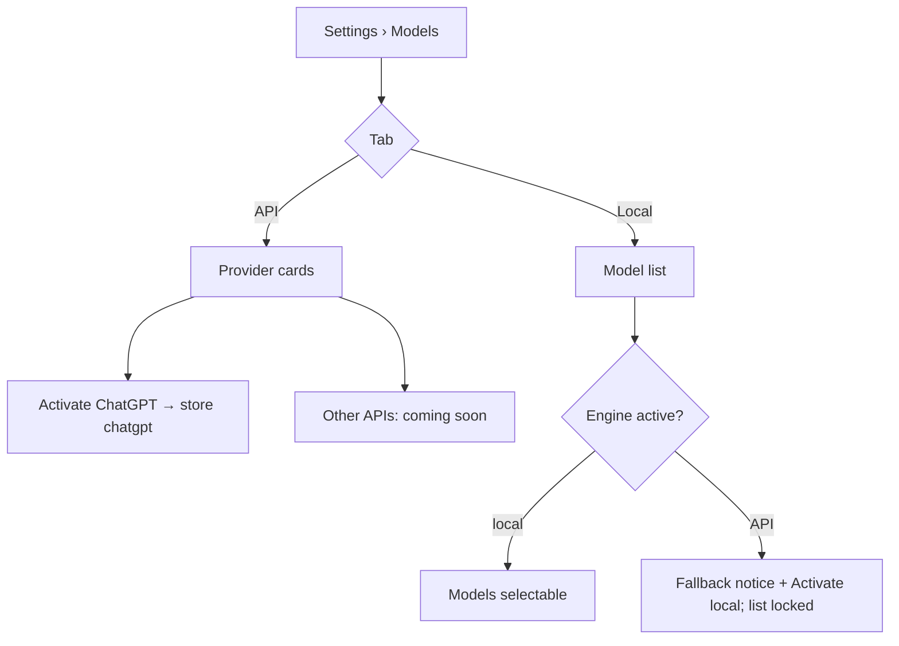
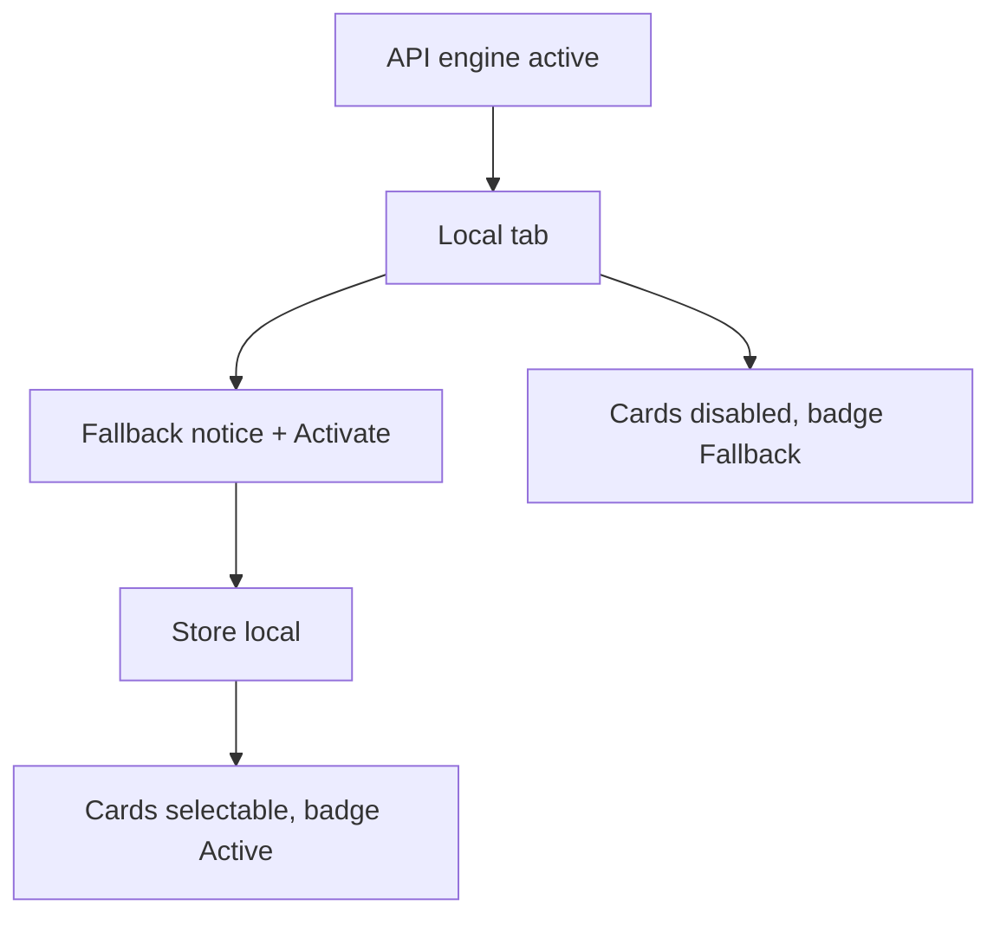
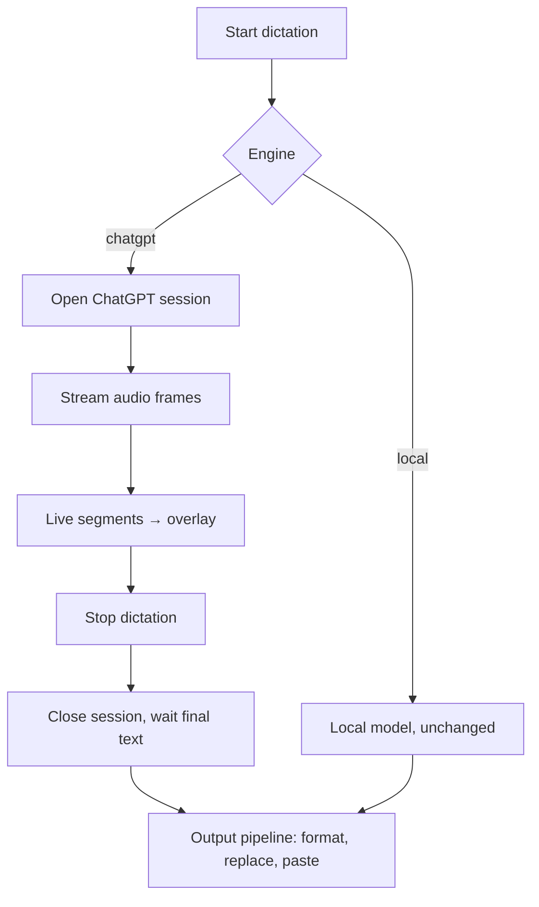
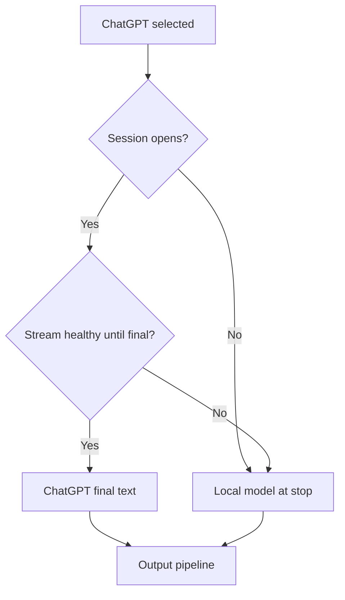
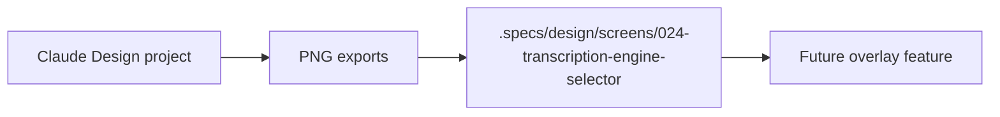

# Feature Specification: Transcription engine selector

**Feature Name:** Transcription engine selector
**Branch:** experiment/chatgpt-dictation
**Date:** 2026-11-23
**Status:** In Progress (AC-008 blocked: mockups not produced)
**Input:** « Il faut que dans les paramètres de Handy on puisse sélectionner le type de moteur : ChatGPT natif via l'abonnement, ou le moteur local comme avant, ou un moteur distant qu'on implémentera ensuite. Que ce soit bien dissocié, un module à part entière ChatGPT. » Plus une maquette Claude Design d'une intégration plus propre de l'overlay live quand un moteur distant transcrit.

## Context

Handy transcribes on the device (transcribe-cpp / ONNX models). An experiment on this branch proved that the ChatGPT desktop dictation stream (`wss://chatgpt.com/backend-api/dictation/stream`), authenticated with the ChatGPT sign-in that Codex stores in `~/.codex/auth.json`, returns live segments then a final text within ~0.8 s after the end of speech. This feature turns the experiment (an environment variable) into a user setting with a clean engine boundary.

## User Scenarios & Testing

### US-1 — Choose the transcription engine in Local / API tabs (P1)

Settings › Models opens on two tabs with icons: **Local** (on-device models, the existing list) and **API** (online engines: ChatGPT now, other providers such as Soniox later). Each tab activates its engine; a dot marks the tab holding the active engine.

**Priority reason:** without the setting, the ChatGPT engine is only reachable through a developer environment variable; tabs keep room for future API providers.
**Independent test:** activate ChatGPT in the API tab or run `handy settings set transcription_engine chatgpt`, read it back, restart, read it again.

```gherkin
Feature: Transcription engine tabs
  Scenario: Activate ChatGPT in the API tab
    Given Handy uses the local engine
    When  the user opens the API tab and activates "ChatGPT"
    Then  the setting transcription_engine is stored as "chatgpt"
    And   the ChatGPT card shows that audio is sent to OpenAI and the sign-in status
    And   the API tab is marked as holding the active engine

  Scenario: Upcoming providers are not selectable yet
    Given the user opens the API tab
    When  the providers are listed
    Then  "Other APIs (Soniox…)" is shown as coming soon and cannot be activated

  Scenario: Invalid value from the CLI
    Given Handy is installed
    When  the user runs "handy settings set transcription_engine remote"
    Then  the command fails with a validation error
    And   the stored engine is unchanged
```



### US-5 — Local models locked while an API engine is active (P1)

With an API engine active, the local model list cannot switch the model: cards are disabled, the active model is labeled "Fallback", and a notice offers to activate the local engine.

**Priority reason:** reported 2026-11-23 — with ChatGPT selected the list still showed "Active" and let the user switch models, which was misleading.
**Independent test:** with ChatGPT active, open the Local tab: cards are not clickable, the badge reads "Fallback"; activate the local engine: cards become selectable again.

```gherkin
Feature: Local model list as fallback
  Scenario: List locked with ChatGPT
    Given transcription_engine is "chatgpt"
    When  the user opens the Local tab
    Then  a notice explains that the selected model is only the fallback
    And   downloaded models cannot be selected
    And   the selected model is labeled "Fallback"

  Scenario: Back to the local engine
    Given transcription_engine is "chatgpt"
    When  the user activates the local engine from the notice
    Then  transcription_engine is stored as "local"
    And   downloaded models can be selected again
```



### US-2 — Dictate with ChatGPT live (P1)

With ChatGPT selected, the user dictates as usual: live text appears in the overlay while speaking, and the final text is delivered like any other dictation (formatting, replacements, paste).

**Priority reason:** this is the value of the engine.
**Independent test:** replay a speech WAV with `handy -f <wav> --live` with the setting on ChatGPT; the JSON text equals the spoken sentence; the log shows a ChatGPT session.

```gherkin
Feature: ChatGPT live dictation
  Scenario: Live text then final text
    Given transcription_engine is "chatgpt"
    And   the user is signed in to ChatGPT through Codex
    When  the user starts a dictation and speaks
    Then  the overlay shows the live text as segments arrive
    When  the user stops the dictation
    Then  the final text from ChatGPT goes through the usual output pipeline

  Scenario: Local engine unchanged
    Given transcription_engine is "local"
    When  the user dictates
    Then  no network connection is opened for transcription
    And   the selected local model transcribes as before
```



### US-3 — Fall back to the local model (P1)

If ChatGPT cannot transcribe (not signed in, network down, server error, timeout), the same recording is transcribed by the local model so no dictation is lost.

**Priority reason:** a remote engine must never lose speech.
**Independent test:** select ChatGPT with an unreadable sign-in file; dictate; the local model produces the text and the log explains the fallback without any token.

```gherkin
Feature: Fallback to the local model
  Scenario: Not signed in
    Given transcription_engine is "chatgpt"
    And   no ChatGPT sign-in is available
    When  the user dictates and stops
    Then  the local model transcribes the recording
    And   the log records the fallback reason without credentials

  Scenario: Stream fails mid-dictation
    Given a ChatGPT session is active
    When  the stream returns an error before the end
    Then  the live preview stops updating
    And   the local model transcribes the full recording at the end
```



### US-4 — Clean live overlay for remote engines (P3, design only)

A Claude Design mockup proposes a unified overlay (destination + live text + engine badge) and the settings control. Implementing the overlay redesign is out of scope for this feature.

```gherkin
Feature: Overlay design proposal
  Scenario: Mockups are available
    Given the feature specification
    When  a reviewer opens the Screens section
    Then  PNG mockups of the live overlay states and the engine setting are referenced

  Scenario: Overlay unchanged by this feature
    Given the ChatGPT engine is active
    When  the user dictates
    Then  the current live overlay is used without visual change
```



## Acceptance Criteria

- **AC-001:** `transcription_engine` accepts `local` and `chatgpt`, defaults to `local`, survives restart and rejects any other value through the settings service and CLI.
- **AC-002:** Settings › Models shows Local and API tabs with icons; the API tab lists ChatGPT (activate button, OpenAI audio notice, sign-in status) and an "Other APIs (Soniox…)" coming-soon card; a dot marks the tab of the active engine; arrow keys move between tabs.
- **AC-003:** With `chatgpt`, a dictation opens one ChatGPT session, emits live text to the overlay and delivers ChatGPT's final text through the existing output pipeline.
- **AC-004:** With `local`, dictation behavior and network use are unchanged.
- **AC-005:** Any ChatGPT failure (no sign-in, connection, server error, timeout) makes the local model transcribe the same recording; logs give the reason and never contain the token.
- **AC-006:** ChatGPT protocol, authentication and transcript assembly live in their own module behind an engine-neutral live session contract; the transcription manager depends only on that contract; no environment variable selects the engine.
- **AC-007:** `handy -f <wav> --live` follows the selected engine.
- **AC-009:** With an API engine active, downloaded models cannot be selected (cards disabled and announced as such), the selected model is labeled "Fallback", and the Local tab offers to activate the local engine.
- **AC-010:** ChatGPT can be selected only while its sign-in is available: signed out, the ChatGPT Activate button is disabled and the settings service refuses a change to `chatgpt` from every writer (settings UI command, running instance, CLI) with `engine_sign_in_required`; an engine already selected stays selected when its sign-in later expires (dictations fall back to the local model).
- **AC-008:** Mockups of the live overlay states and the engine setting are exported from Claude Design and referenced in Screens.

## Functional Requirements

- <a id="fr-001"></a>**FR-001:** Persist the engine choice as a validated closed setting (AC-001).
- <a id="fr-002"></a>**FR-002:** Provide Local / API engine tabs with activation and the ChatGPT sign-in status in Settings › Models (AC-002).
- <a id="fr-003"></a>**FR-003:** Stream dictation audio to ChatGPT and surface live and final text (AC-003, AC-007).
- <a id="fr-004"></a>**FR-004:** Keep the local engine path unchanged when selected (AC-004).
- <a id="fr-005"></a>**FR-005:** Fall back to the local model on any remote failure, with safe logs (AC-005).
- <a id="fr-006"></a>**FR-006:** Isolate each engine behind a neutral live session contract (AC-006).
- <a id="fr-008"></a>**FR-008:** Lock local model selection while an API engine is active and present the selected model as the fallback (AC-009).
- <a id="fr-009"></a>**FR-009:** Allow selecting an API engine only while its sign-in is available (AC-010).
- <a id="fr-007"></a>**FR-007:** Provide overlay and setting mockups for live remote engines (AC-008).

## Key Entities

- **TranscriptionEngine** — closed choice `Local | ChatGpt` stored in `settings_store.json`.
- **LiveSession** — one remote dictation: send audio, poll live text, finish to the final text.
- **ChatGPT sign-in** — access token and account id read from `~/.codex/auth.json` (never stored or logged by Handy).

## Edge Cases

- No local model installed and ChatGPT fails: same behavior as today without a model (existing error path).
- Sign-in expired: the server refuses the session → fallback; status shows the sign-in file, not token validity.
- ChatGPT workspace accounts refused by the server → fallback.
- Dictation longer than the server session limit (5 min) → server error → fallback for the whole recording.
- Empty speech: ChatGPT returns empty text → existing empty-result handling.
- Server closes the session before the user stops (lifetime, shutdown) → treated as a failure → local fallback for the whole recording.
- Unresponsive network: connection, TLS/upgrade and writes are bounded (5 s / 10 s / 2 s), start ≤ 10 s, final text ≤ 8 s → local fallback; name resolution relies on the system resolver timeout.
- Language: `auto` sends no hint; regional/script variants send their primary code (`zh-Hans` → `zh`).
- Onboarding not finished: the fallback lock does not apply, so the first local model can always be chosen.
- Tray model menu with an API engine: entries stay listed; a click is refused (logged) and the selection is unchanged — no visible feedback yet (follow-up).
- Fallback speed: with ChatGPT selected the long-dictation prefetch of feature 022 does not run, so a fallback transcribes the whole recording after the stop (no text lost, slower on long dictations).

## Success Criteria

- **SC-001:** Final text available ≤ 1.5 s after stop for a 5 s phrase on a normal connection (measured 0.75–0.85 s on 2026-11-23).
- **SC-002:** 0 lost dictations across forced failures (no sign-in, offline).

## Open Follow-ups

Review findings deferred from PR #10 (2026-11-23):

- **Start without a local model.** With ChatGPT active, a dictation does not start when the local fallback model is not installed (`src-tauri/src/actions.rs`, pre-recording model check). The check should apply to the local engine only, and a missing fallback should be reported only when the remote transcription fails.
- **Language picker follows the fallback model.** With ChatGPT active, `ModelSettingsCard` shows or filters the language picker from the fallback model, but the selected language is sent to ChatGPT. Which languages ChatGPT offers is a product decision.
- **"Translate to English" with ChatGPT.** The toggle stays visible, but the ChatGPT session returns source-language text, while the local fallback translates. The fix (implement translation, route to the local model, or hide the control) is a product decision.
- **Refused tray model switch.** The tray menu gives no visible feedback when a model switch is refused while an API engine is active.

## Screens

Implemented tabs (Playwright harness, real components): [engine-tab-local.png](baselines/engine-tab-local.png), [engine-tab-api.png](baselines/engine-tab-api.png), [engine-tab-local-fallback.png](baselines/engine-tab-local-fallback.png), [engine-signed-out.png](baselines/engine-signed-out.png).

Mockups (Claude Design, proposal for a later overlay feature) — **not produced yet** (2026-11-23): the native-app automation tools were unavailable (`codex-computer-use`: "no hook answered this call"; `cmux-cua`: "Computer Use onboarding is still in progress"). Expected files:
- [overlay-live-chatgpt.png](../../design/screens/024-transcription-engine-selector/overlay-live-chatgpt.png)
- [overlay-live-local.png](../../design/screens/024-transcription-engine-selector/overlay-live-local.png)
- [overlay-finalizing.png](../../design/screens/024-transcription-engine-selector/overlay-finalizing.png)
- [overlay-fallback-local.png](../../design/screens/024-transcription-engine-selector/overlay-fallback-local.png)
- [settings-transcription-engine.png](../../design/screens/024-transcription-engine-selector/settings-transcription-engine.png)

## QE Analysis

| Dimension | Risk | Expected evidence | Boundary |
|---|---|---|---|
| Functional (setting, routing) | Medium | Rust unit tests (descriptor, defaults, validation), store mapping test | cargo test, bun test |
| Integration (ChatGPT stream) | High — private undocumented API | Real CLI replay with the setting on chatgpt; log of session + final text | Manual run, recorded in changelog |
| Resilience (fallback) | High — speech loss | Forced no-sign-in run produces local text | CLI replay with `HOME`-independent override test in Rust (auth path injected) |
| Security/privacy | Medium — token handling | Code review: token only in request headers, no log | Final review |
| UI | Low | Render of the control, translations check | bun test, check:translations |

Gaps: no automated test against the live ChatGPT server (network, credentials); the overlay redesign is design-only.
