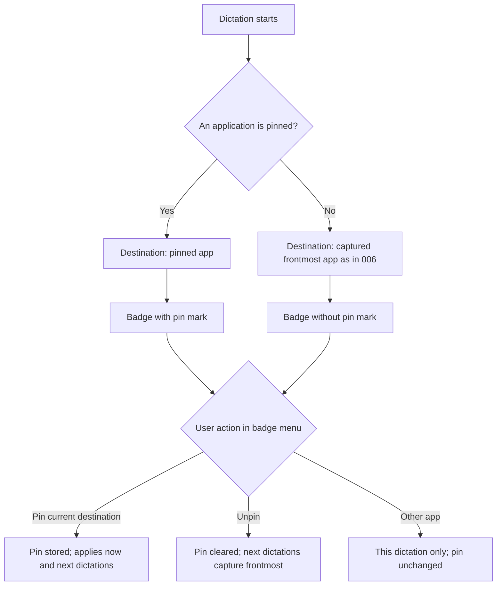
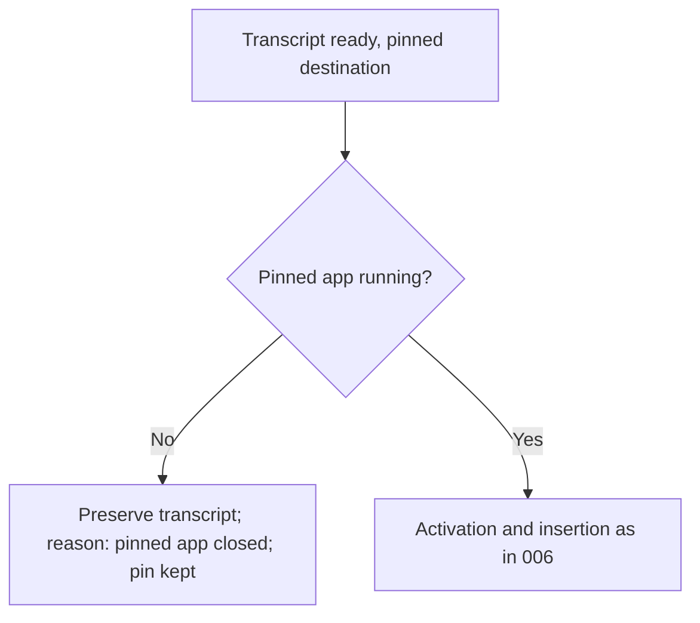
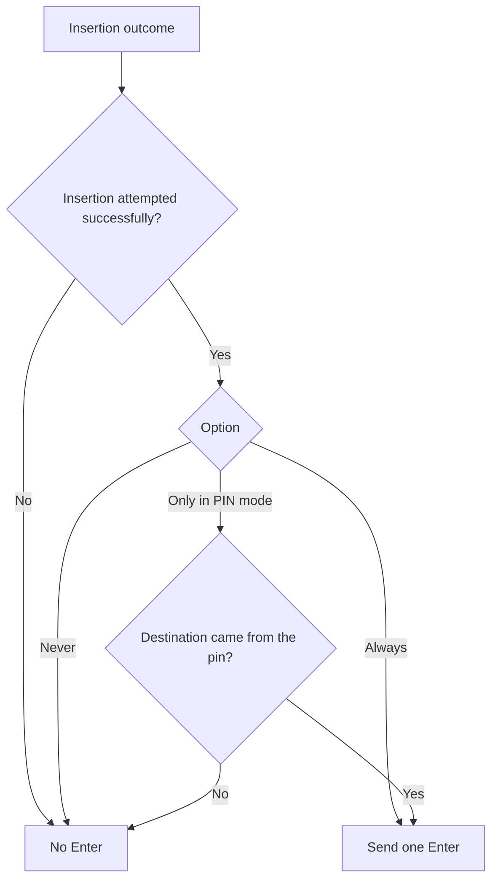
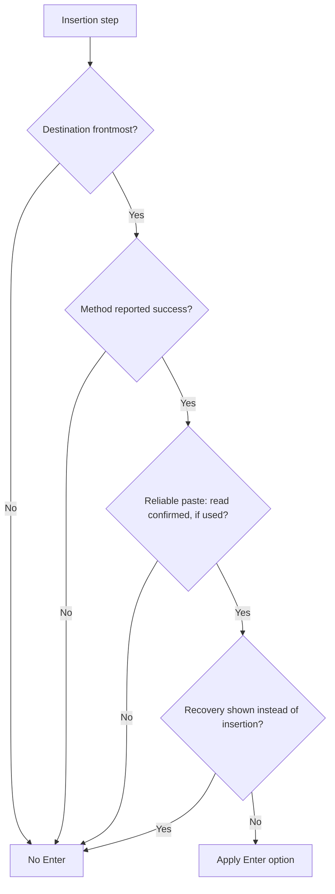
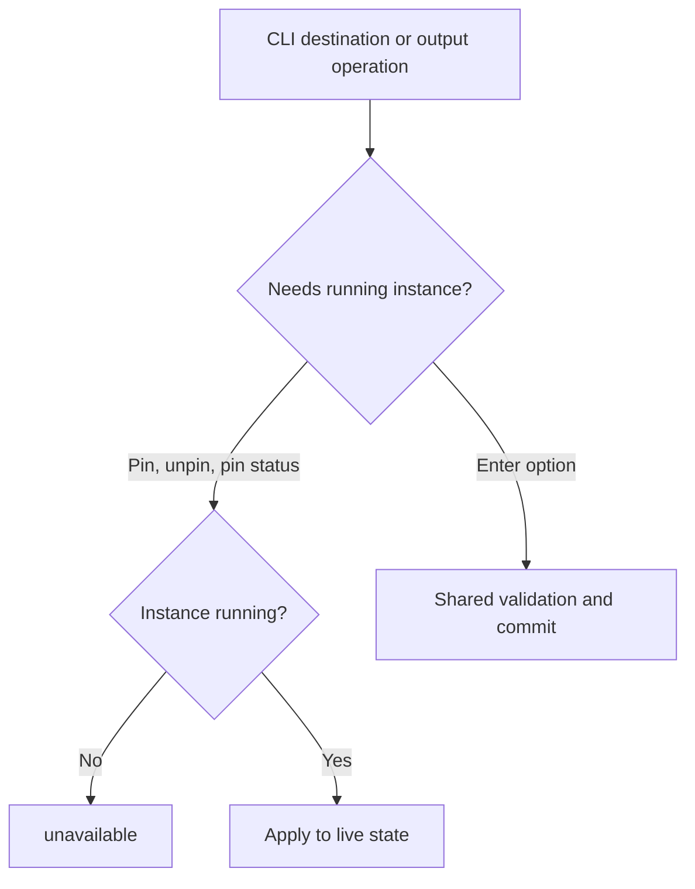

# Feature Spec: PIN Mode and Enter Rule

## Header

- **Feature:** PIN Mode and Enter Rule
- **Branch:** None — specification only (program specified before `spec-ship`)
- **Date:** 2026-10-12
- **Status:** Draft
- **Input:** Program item 9: from the destination badge, pin an application so that following dictations keep being sent to it, despite application switches and transcription stops/restarts, until it is unpinned. Provide a single automatic Enter option: Never; Always; Only in PIN mode. Avoid any duplicate with the existing automatic Enter mechanism. Trigger Enter only after a successful insertion according to the chosen contract. Program item 8 requires the settings CLI to read and modify destination/PIN and output behaviors.
- **Feature Number:** 009

## User Scenarios & Testing

### Story 1 — Pin a destination from the badge `P1`

**As a** Handy user, **I want to** pin the destination application from the badge, **so that** all my next dictations go there while I read or work elsewhere.

**Priority reason:** Pinning is the core of this item.
**Independent test:** Pin ChatGPT during a dictation, then dictate three times from other applications and check where each text lands.

```gherkin
Feature: Pin a destination
  Scenario: Pin from the badge
    Given a dictation is recording with destination ChatGPT
    When the user opens the badge menu and chooses "Pin ChatGPT"
    Then the badge shows ChatGPT with a pin mark
    And this dictation and the following ones are sent to ChatGPT
  Scenario: Pinned across app switches and new dictations
    Given ChatGPT is pinned
    When the user starts a dictation while Safari is frontmost
    Then the destination of this dictation is ChatGPT
    And at the end Handy activates ChatGPT and inserts the text there
  Scenario: Unpin
    Given ChatGPT is pinned
    When the user chooses "Unpin" in the badge menu
    Then the pin mark disappears
    And the next dictation captures the frontmost application again
```



### Story 2 — Pinned application unavailable `P1`

**As a** Handy user, **I want to** keep my text when the pinned application is closed, **so that** a stale pin never sends text to the wrong window.

**Priority reason:** A pin outliving its application is the main failure mode.
**Independent test:** Pin Notes, quit Notes, dictate.

```gherkin
Feature: Pinned app unavailable
  Scenario: Pinned app closed
    Given Notes is pinned and Notes is not running
    When the user dictates
    Then no text is inserted into any application
    And the transcript is preserved as in feature 006
    And the pin stays until the user unpins it
  Scenario: Pinned app reopened
    Given Notes is pinned and was closed
    When Notes is reopened and the user dictates
    Then the text is inserted into Notes
```



### Story 3 — One automatic Enter option `P1`

**As a** Handy user, **I want to** choose Never, Always or Only in PIN mode for automatic Enter, **so that** messages are sent automatically only where I want.

**Priority reason:** The single option replaces today's on/off auto-submit and prevents duplicate Enter presses.
**Independent test:** For each value, dictate once pinned and once not pinned, and count Enter presses received by a test field.

```gherkin
Feature: Automatic Enter option
  Scenario: Only in PIN mode, pinned
    Given automatic Enter is "Only in PIN mode"
    And ChatGPT is pinned
    When a dictation is inserted into ChatGPT successfully
    Then exactly one Enter key press is sent after the insertion
  Scenario: Only in PIN mode, not pinned
    Given automatic Enter is "Only in PIN mode"
    And nothing is pinned
    When a dictation is inserted successfully
    Then no Enter key press is sent
  Scenario: Always
    Given automatic Enter is "Always"
    When a dictation is inserted successfully
    Then exactly one Enter key press is sent
  Scenario: Never
    Given automatic Enter is "Never"
    When a dictation is inserted successfully
    Then no Enter key press is sent
  Scenario: Upgrade from the existing auto-submit
    Given the existing auto-submit was on with key Ctrl+Enter
    When settings load after upgrade
    Then automatic Enter is "Always" with key Ctrl+Enter
    And no other auto-submit control remains in the settings
```



### Story 4 — Enter only after a successful insertion `P1`

**As a** Handy user, **I want to** never have Enter pressed when my text did not land, **so that** an empty or wrong message is never sent.

**Priority reason:** An Enter after a failed insertion can send an empty message or trigger an unintended action.
**Independent test:** Inject activation failure, insertion failure and recovery display, with automatic Enter "Always".

```gherkin
Feature: Enter after a successful insertion only
  Scenario: Destination unavailable
    Given automatic Enter is "Always"
    When the destination is unavailable at insertion time
    Then no Enter key press is sent
  Scenario: Insertion method failed
    Given automatic Enter is "Always"
    When the insertion method reports failure
    Then no Enter key press is sent
  Scenario: Paste method none
    Given the paste method is "none"
    When a dictation completes
    Then no Enter key press is sent
  Scenario: Reliable paste without confirmed read
    Given the beta reliable paste is on and completes its transfer
    When the target never reads the clipboard
    Then no Enter key press is sent
  Scenario: Destination left before Enter
    Given automatic Enter is "Always" and the text was inserted into ChatGPT
    When another application becomes frontmost before the Enter press
    Then no Enter key press is sent
```



### Story 5 — PIN and Enter from the CLI `P2`

**As an** automation user, **I want to** pin, unpin, read the pin and set the Enter option from the CLI, **so that** I can switch modes from scripts.

**Priority reason:** Program item 8 lists destination/PIN and output behaviors for the CLI.
**Independent test:** Pin by application identifier through the CLI on a running instance, dictate, unpin, and set each Enter option.

```gherkin
Feature: PIN and Enter through the settings CLI
  Scenario: Pin by identifier
    Given Handy is running and Comet is running
    When the user pins the Comet application identifier through the CLI with JSON output
    Then stdout reports the pinned application and the badge shows the pin mark at the next dictation
  Scenario: Pin status without a running app
    Given Handy is not running
    When the user reads the pin status through the CLI
    Then the command returns the stable code "unavailable"
  Scenario: Invalid Enter option
    When the user sets automatic Enter to "sometimes"
    Then the command fails with "validation_failed" listing never, always and pin_only
```



## Acceptance Criteria

### AC-001

**Criterion:** The badge menu of feature 006 offers "Pin <destination>" when nothing or another app is pinned and "Unpin" when an app is pinned. Pinning stores the destination's identity and makes it the destination of the current dictation and of every following dictation, whatever application is frontmost at their start, until unpinned or until Handy quits. The badge shows a pin mark and the accessible name "Destination: <name>, pinned".
**Priority:** P1 | **Story:** Story 1

### AC-002

**Criterion:** While an app is pinned, choosing another application in the badge menu changes the destination of the current dictation only; the pin is unchanged. Unpinning before insertion begins makes the current dictation's destination the application captured at its start as in 006 (source "captured", so "Only in PIN mode" sends no Enter for it); the next dictation captures the frontmost application as in 006. Pinning is an explicit choice: a pinned destination is activated even when the 006 "Return to the dictation's application" setting is off.
**Priority:** P1 | **Story:** Story 1

### AC-003

**Criterion:** When the pinned application is not running, or cannot be activated within the 006 limit, no text is inserted anywhere, the transcript is preserved as specified by 006 with the reason "pinned app unavailable", and the pin remains. When an application with the pinned identity runs again, following dictations go to it.
**Priority:** P1 | **Story:** Story 2

### AC-004

**Criterion:** A single setting "Automatic Enter" with values Never, Always and Only in PIN mode replaces the existing auto-submit switch; the existing key choice (Enter, Ctrl+Enter, Cmd+Enter) is kept as the key to press. Upgrade maps auto-submit off to Never and on to Always and keeps the key. No other automatic Enter or auto-submit control remains, so at most one Enter press is sent per dictation.
**Priority:** P1 | **Story:** Story 3

### AC-005

**Criterion:** The Enter press is sent at most once, after the insertion step, only when: the dictation has a destination and it is still frontmost immediately before the Enter press, or the dictation has no destination (insertion targets the frontmost application as today); the insertion method reported success; when the beta reliable paste completed the transfer, the target's read of the clipboard was confirmed, and when it fell back to the classic paste, the classic paste reported success; no recovery display (010) replaced the insertion; and the paste method is not "none". "Only in PIN mode" additionally requires that the dictation's destination came from the pin. Otherwise no Enter is sent.
**Priority:** P1 | **Story:** Stories 3 and 4

### AC-006

**Criterion:** The settings CLI (008) offers `destination pin <identifier|current>` (`current` pins the destination of the dictation in progress, or the frontmost application other than Handy when idle; an identifier must belong to a running application, otherwise `not_found`), `destination unpin` and `destination status` (pinned app or none) against a running instance, returning `unavailable` without one, and reads and sets the Automatic Enter option and key with the UI validation (`never`, `always`, `pin_only`). With `--json`, stdout contains only the JSON envelope.
**Priority:** P2 | **Story:** Story 5

## Behavioral AC

Signals extracted: badge, menu, dropdown, select, toggle, pin, keyboard navigation. Official `detect_traits` returned has_dropdown, is_keyboard_navigable.

### has_dropdown

<!-- WARNING: No visual states defined for trait "has_dropdown" in ui-behavioral-taxonomy.md -->

```gherkin
Feature: Pin entries in the badge menu
  Scenario: Pin entry shown
    Given nothing is pinned and the badge menu is open
    When the user reads the menu
    Then "Pin <destination>" is listed above the application list
  Scenario: Automatic Enter selector
    Given the output settings are open
    When the user opens the Automatic Enter selector
    Then Never, Always and Only in PIN mode are listed with the current value marked
```

### is_keyboard_navigable

<!-- WARNING: No visual states defined for trait "is_keyboard_navigable" in ui-behavioral-taxonomy.md -->

```gherkin
Feature: Keyboard access to Automatic Enter
  Scenario: Change the option with the keyboard
    Given the Automatic Enter selector has focus
    When the user picks Only in PIN mode with arrow keys and Enter
    Then the option is saved and announced
  Scenario: Tab order
    Given the output settings are open
    When the user presses Tab
    Then the Automatic Enter selector and its key selector receive visible focus in reading order
```

## Functional Requirements

### FR-001

**Requirement:** Store a session pin (application identity) set and cleared from the badge menu or CLI, and resolve each dictation's destination from the pin before the frontmost-app capture of 006.
**AC References:** AC-001, AC-002, AC-006

### FR-002

**Requirement:** Treat an unavailable pinned application as an unavailable destination without clearing the pin.
**AC References:** AC-003

### FR-003

**Requirement:** Replace the auto-submit switch by one three-value Automatic Enter setting with migration and a retained key choice.
**AC References:** AC-004, AC-006

### FR-004

**Requirement:** Send at most one Enter press per dictation, gated by the insertion outcome contract and the option value.
**AC References:** AC-005

## Key Entities

| Entity | Description | Key fields |
|---|---|---|
| Pin | Session-level pinned destination | application identity, display name, icon, pinned at |
| Automatic Enter setting | Persistent option | value (never, always, pin_only), key (Enter, Ctrl+Enter, Cmd+Enter) |
| Dictation destination source | Origin of a dictation's destination | captured, badge choice, pin |

## Clarifications

- Current code (2026-10-12): `auto_submit` (on/off) with `auto_submit_key` (Enter, Ctrl+Enter, Cmd+Enter); on the normal path Enter fires 50 ms after the paste returns whenever auto-submit is on and the paste method is not none; on the beta reliable path it fires only after a confirmed read.
- `[ASSUMED]` The pin lasts until unpinned or until Handy quits; it is not restored after a restart, so a forgotten pin never sends text after a reboot.
- `[ASSUMED]` Pinning requires destination support (006, macOS and Windows); where unsupported, pin entries are not offered and the CLI returns `validation_failed` with the platform reason. With the overlay style none, pinning is available through the CLI only.
- `[ASSUMED]` New installations default to Automatic Enter "Never", matching today's auto-submit default (off).
- The migration covers every current auto-submit path (classic paste, reliable paste on macOS and Windows, settings commands and UI) so that no second Enter mechanism remains.
- "Successful insertion" follows the 006 contract: insertion attempted with the method reporting success; it is not a verification of the field content.
- Program context: specified in list order (001–010); depends on 006 (destination, badge) and 008 (CLI); 010 recovery display suppresses Enter.

## QE Analysis

- **Criticality:** High; **Blast radius:** Text routing and automatic message sending; **Primary risk:** Enter sent after a failed or misrouted insertion; **Confidence:** Medium (auto-submit paths read, nothing executed).
- **Dimensions:** Functional correctness, safety of automatic actions, data migration, regression, accessibility, UX.
- **P0 gates/evidence:** Gate table tests for AC-005 (each condition false blocks Enter); option × pin matrix tests; migration tests from auto-submit on/off with each key; pin resolution and unpin timing tests.
- **P1 gates/evidence:** Native checks pinning ChatGPT and Comet with application switches; Enter count measured by a test field; CLI pin operations against a running instance.
- **Non-functional expectations:** Exactly zero or one Enter per dictation; Enter sent within 100 ms after a successful insertion step; no window titles or text logged above debug level.
- **Missing evidence:** No runtime test; mockups deferred before `spec-ship`.
- **Boundary:** QE defines risk and test sufficiency; the independent review judges requirements; Penflow governs UI design evidence; spec-test executes runtime proof.

## Screens

| Screen | Status | Reference |
|--------|--------|-----------|
| recording-indicator | Modified | Mockup to produce before `spec-ship` (pin entries and pin mark) |
| output-settings | Modified | Mockup to produce before `spec-ship` (Automatic Enter selector) |

## Penflow Contract

- Planned `flow_id: pin-mode-and-enter-rule`, `screen_id: recording-indicator` and `screen_id: output-settings`. Per the user decision of 2026-10-12 (lightweight UI contract), the Penflow flow/screen contract, semantic and test IDs and the Pencil mockups are produced in one pass for all program features before `spec-ship`; the planned IDs above are authoritative until then. No inspection READY or certification PASS is claimed.

## Edge Cases

- Pinned application is Handy's own window: not possible, Handy is excluded from destinations.
- Pin set while no dictation is running (CLI): applies from the next dictation.
- Two instances of the pinned application (same identity): the one activation brings forward is used, as in 006.
- Automatic Enter key Cmd+Enter on Windows/Linux: kept as stored; the key choice behaves as today per platform.

## Success Criteria

### SC-001

Across the full option × pin × outcome matrix in automated tests, the number of Enter presses equals the expected value (0 or 1) in 100% of cases.

### SC-002

Upgrade tests map every existing auto-submit combination to the documented Automatic Enter value with the same key.

### SC-003

In native checks, a pinned ChatGPT receives five consecutive dictations started from three other applications.
