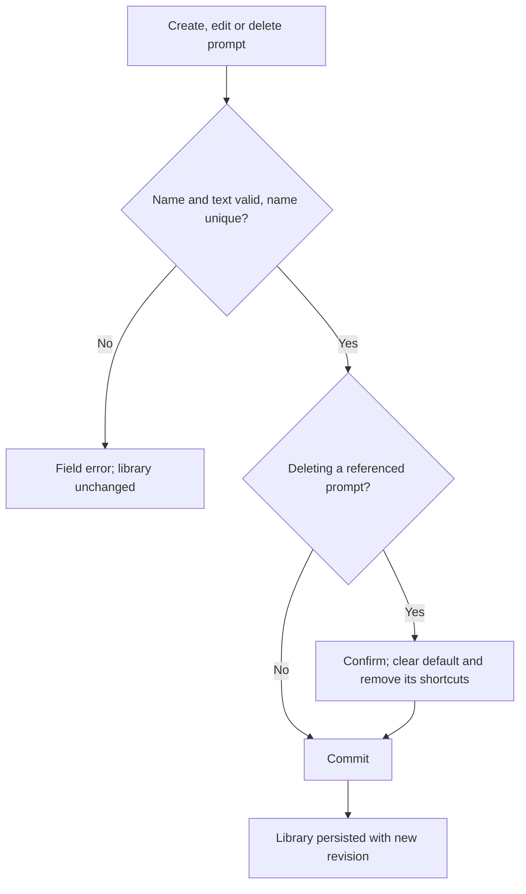
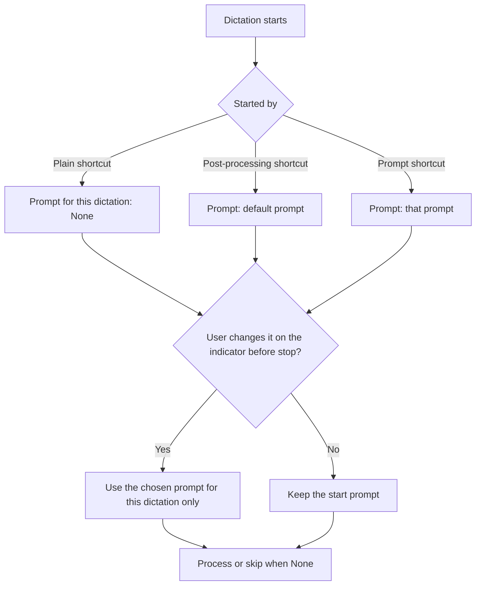
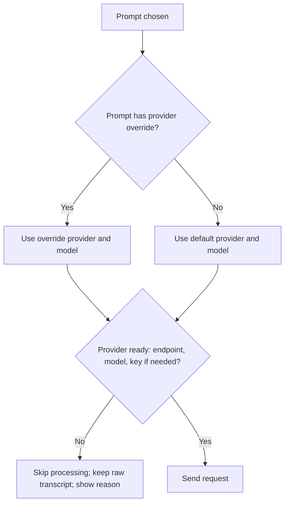
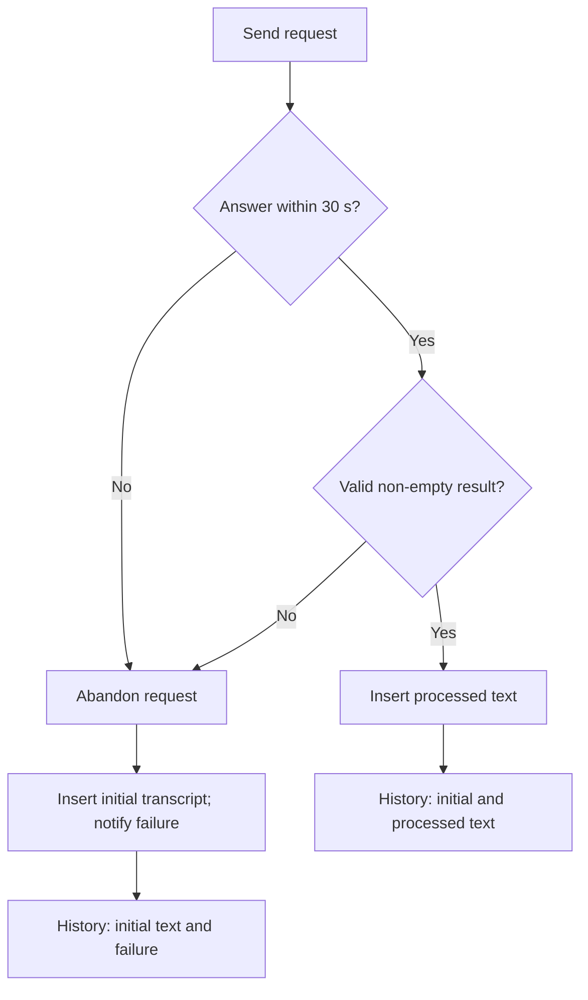
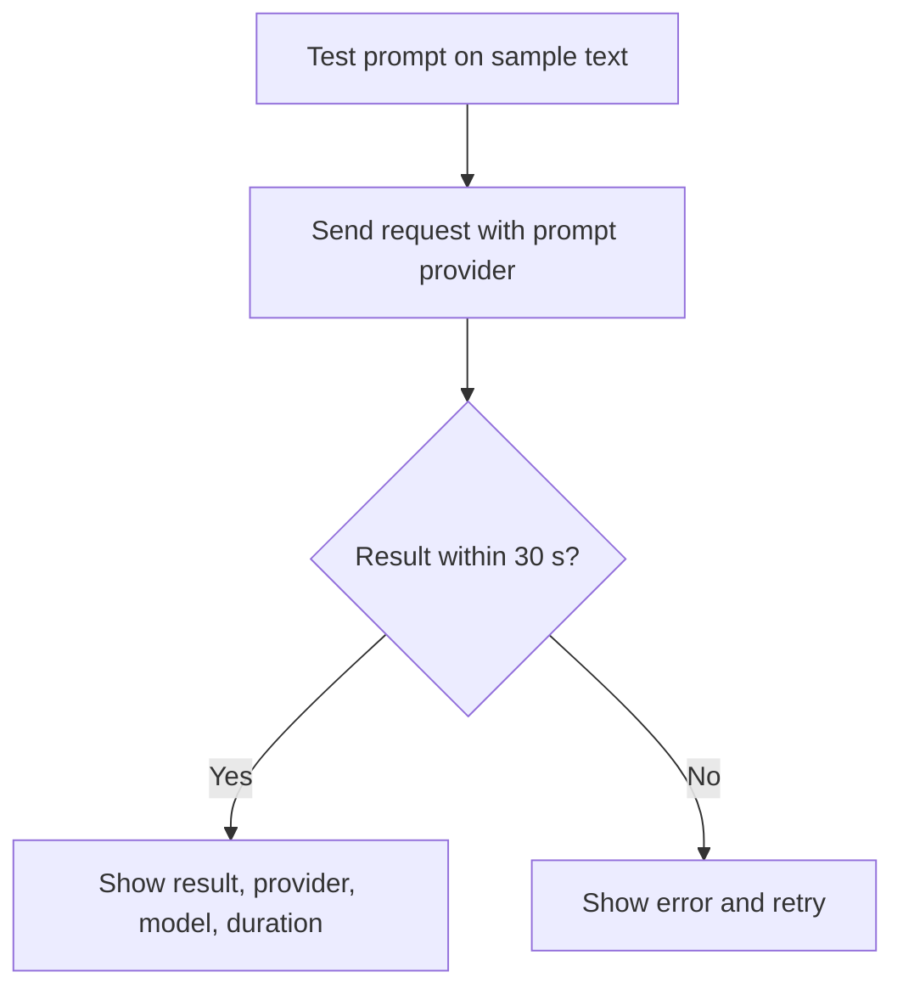
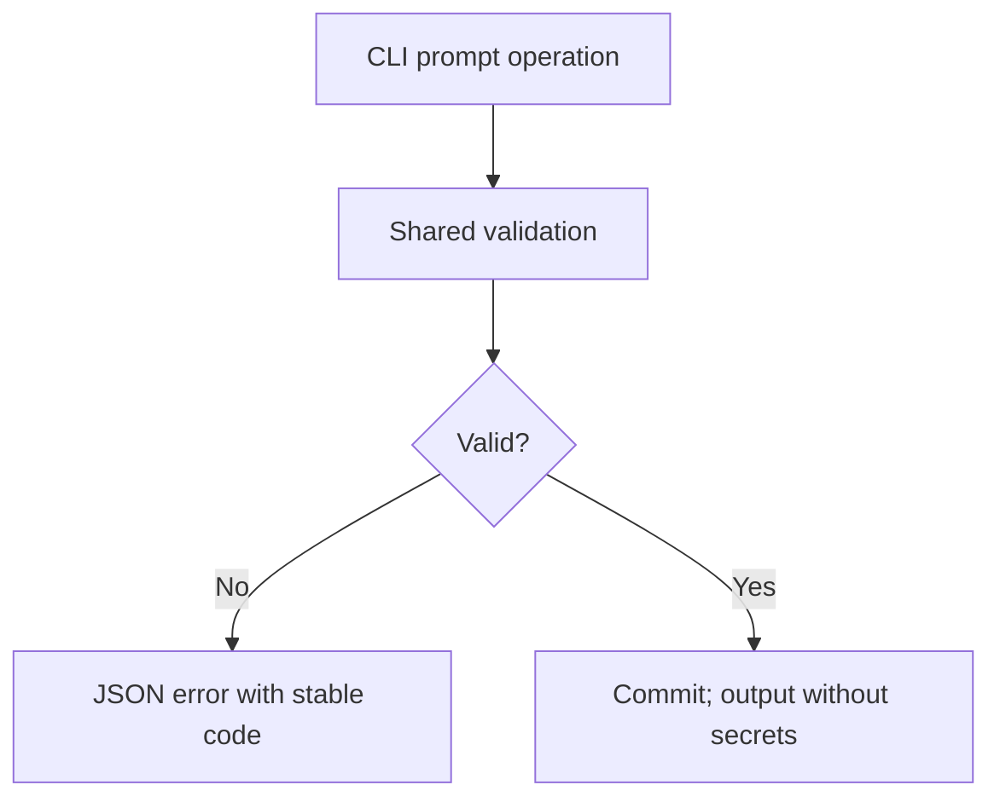

# Feature Spec: Custom AI Prompts

## Header

- **Feature:** Custom AI Prompts
- **Branch:** None — specification only (program specified before `spec-ship`)
- **Date:** 2026-10-12
- **Status:** Draft
- **Input:** Program item 5: create, name, edit and delete transcript-processing prompts: minimal correction, friendly rephrasing, clarification, shortening, notes, translation… Select them from the settings and from the dictation indicator, with an optional associated shortcut and a test. Allow processing by a local or remote AI, with provider and model configuration. Keep the initial transcript if processing fails. The extra actions visible in Spokenly screenshots (scripts, launching apps, OCR) are not requested. Program item 8 requires the settings CLI to read and modify prompts.
- **Feature Number:** 005

## User Scenarios & Testing

### Story 1 — Manage a prompt library `P1`

**As a** Handy user, **I want to** create, name, edit and delete processing prompts, **so that** I can keep one prompt per writing need.

**Priority reason:** The library is the base of selection, shortcuts and tests.
**Independent test:** Create "Shorten", edit its text, restart, delete it, and check the list each time.

```gherkin
Feature: Prompt library
  Scenario: Starter prompts on first use
    Given the user has only the existing "Improve Transcriptions" prompt
    When the settings load after upgrade
    Then the library also contains the starter prompts "Minimal correction", "Friendly rephrasing", "Clarify", "Shorten", "Notes" and "Translate to English"
    And "Improve Transcriptions" is unchanged
  Scenario: Create and edit a prompt
    When the user creates a prompt named "Formal email" with a text containing "${output}"
    And later changes its text and saves
    Then the library lists "Formal email" with the new text after restart
  Scenario: Reject an invalid prompt
    Given the prompt name or text is empty
    When the user inspects Save
    Then Save stays disabled and a field error explains what is missing
    And the library is unchanged
  Scenario: Delete the default prompt
    Given "Shorten" is the default prompt
    When the user deletes "Shorten" and confirms
    Then the default prompt becomes "None"
    And shortcuts bound to "Shorten" are removed and reported
```



### Story 2 — Choose the prompt for a dictation `P1`

**As a** Handy user, **I want to** pick the prompt in the settings or from the dictation indicator, **so that** each dictation gets the processing I need.

**Priority reason:** Selection from the indicator is explicitly requested and changes how processing is triggered.
**Independent test:** Set a default prompt in settings, start a post-processing dictation, change the prompt from the indicator during the recording, and check which prompt processed the text.

```gherkin
Feature: Prompt selection
  Scenario: Default prompt from settings
    Given "Minimal correction" is the default prompt
    When the user dictates with the post-processing shortcut
    Then the transcript is processed with "Minimal correction"
  Scenario: Change the prompt from the indicator
    Given a dictation is recording and the indicator shows "Minimal correction"
    When the user opens the prompt menu on the indicator and chooses "Shorten"
    Then the indicator shows "Shorten"
    And this dictation is processed with "Shorten"
    And the default prompt in settings is still "Minimal correction"
  Scenario: Process a plain dictation from the indicator
    Given a dictation started with the plain dictation shortcut shows "None" on the indicator
    When the user chooses "Notes" on the indicator before the recording stops
    Then this dictation is processed with "Notes"
  Scenario: Choosing None skips processing
    Given a post-processing dictation is recording
    When the user chooses "None" on the indicator
    Then the raw transcript is inserted without AI processing
```



### Story 3 — Configure local or remote AI per prompt `P1`

**As a** Handy user, **I want to** run a prompt with a local or a remote provider and model, **so that** I can keep private text local and use a stronger remote model when needed.

**Priority reason:** Provider choice is explicitly requested and affects privacy and cost.
**Independent test:** Configure "Minimal correction" to use the local provider and "Translate to English" to use a remote provider; process one dictation with each and inspect the request target.

```gherkin
Feature: Provider and model per prompt
  Scenario: Prompt uses the default provider
    Given "Notes" has no provider override
    When a dictation is processed with "Notes"
    Then the default provider and its model are used
  Scenario: Prompt overrides provider and model
    Given "Minimal correction" uses the local custom provider at "http://localhost:11434/v1" with model "llama3.2"
    When a dictation is processed with "Minimal correction"
    Then the request goes to that local endpoint with that model
  Scenario: Provider not ready
    Given "Translate to English" uses a remote provider without an API key
    When the user selects it in settings
    Then the prompt shows that its provider is not ready and how to fix it
```



### Story 4 — Keep the transcript when processing fails `P1`

**As a** Handy user, **I want to** always get my words even when the AI fails, **so that** a dictation is never lost.

**Priority reason:** Losing text is the worst outcome of a dictation tool.
**Independent test:** Point a prompt at an unreachable endpoint, then at an endpoint that times out, and dictate each time.

```gherkin
Feature: Fallback to the initial transcript
  Scenario: Provider error
    Given the chosen prompt's provider returns an error
    When the dictation is processed
    Then the initial transcript is inserted
    And the indicator says AI processing failed and the original text was inserted
    And the history keeps the initial transcript and records the failure
  Scenario: Timeout
    Given the provider does not answer within 30 seconds
    When the dictation is processed
    Then processing is abandoned and the initial transcript is inserted
  Scenario: Cancel during processing
    Given processing is in progress
    When the user cancels the operation
    Then nothing is inserted
```



### Story 5 — Shortcut and test for a prompt `P2`

**As a** Handy user, **I want to** bind a shortcut to a prompt and test a prompt on sample text, **so that** I can dictate straight into a prompt and check its result first.

**Priority reason:** Both are requested but build on Stories 1–4.
**Independent test:** Bind a shortcut to "Notes", dictate with it; test "Shorten" on a sample text and compare the output pane.

```gherkin
Feature: Prompt shortcuts and test
  Scenario: Dictate with a prompt shortcut
    Given "Notes" has the shortcut "ctrl+option+n"
    When the user dictates with "ctrl+option+n"
    Then the dictation is processed with "Notes"
  Scenario: Shortcut conflict
    When the user binds "Notes" to the dictation shortcut "option+space"
    Then the shortcut is rejected as used by the dictation action
  Scenario: Test a prompt
    Given the test box contains the last transcript
    When the user runs the test for "Shorten"
    Then the processed result is shown with the provider, model and duration
    And nothing is inserted into any application and the history is unchanged
```



### Story 6 — Manage prompts from the CLI `P2`

**As an** automation user, **I want to** list, create, update, delete and select prompts from the CLI, **so that** agents can provision processing.

**Priority reason:** The settings CLI (008) covers prompts from its first version.
**Independent test:** Run every operation with `--json` on an isolated store with a configured API key and check it never appears in any output.

```gherkin
Feature: Prompts through the settings CLI
  Scenario: Create and select a prompt
    When the user creates a prompt "Formal email" and sets it as default with JSON output
    Then stdout lists the prompt id and the new revision
  Scenario: API key never echoed
    Given a remote provider has an API key configured in settings
    When the user lists prompts with JSON output
    Then no command output, error or log line contains the key
    And the prompt's provider is reported as ready
```



## Acceptance Criteria

### AC-001

**Criterion:** The settings UI lists prompts with name, provider (default or override) and shortcut, and supports create, edit and delete with confirmation. A prompt is valid when its trimmed name has 1–60 characters and is unique case-insensitively, and its text has 1–8000 characters. The library holds at most 50 prompts. Changes persist across restarts.
**Priority:** P1 | **Story:** Story 1

### AC-002

**Criterion:** On upgrade, existing prompts and the existing selected prompt are kept unchanged, and the starter prompts Minimal correction, Friendly rephrasing, Clarify, Shorten, Notes and Translate to English are added once when absent by name; they are editable and deletable. Starter prompts are added only while the library has room under its limit. Existing prompts that break the new validation rules are kept, flagged invalid and cannot be used until edited.
**Priority:** P1 | **Story:** Story 1

### AC-003

**Criterion:** The existing "AI post-processing" switch keeps its meaning: when off, no dictation is processed, prompt shortcuts are unregistered and the indicator menu is hidden. When on, settings define one default prompt or "None". The plain dictation shortcut starts with "None", the post-processing shortcut with the default prompt, and a prompt shortcut with its prompt. While a dictation is recording, the indicator shows the prompt for this dictation and offers a menu listing "None" and every prompt; a choice applies to this dictation only and does not change the default. The menu opens within 200 ms without taking keyboard focus from the user's application, on every platform where the indicator is shown.
**Priority:** P1 | **Story:** Story 2

### AC-004

**Criterion:** Each prompt uses the default provider and model unless it defines a provider and model override. Providers are the existing ones, including the local custom OpenAI-compatible endpoint and, where available, Apple Intelligence. A prompt whose provider lacks a required endpoint, model or API key is shown as not ready with the missing item; processing with it skips the AI step.
**Priority:** P1 | **Story:** Story 3

### AC-005

**Criterion:** When the AI step fails (provider or HTTP error, empty or whitespace-only result, provider not ready) or the whole step, including any internal retry or fallback request, exceeds 30 seconds, the initial transcript is inserted, the indicator states for at least 4 seconds that processing failed and the original was inserted, and the history keeps the initial transcript, the prompt name and the failure reason. Cancelling during processing inserts nothing; history behaves as today for cancelled dictations.
**Priority:** P1 | **Story:** Story 4

### AC-006

**Criterion:** A prompt may have 0–2 shortcuts. A prompt shortcut starts a dictation processed with that prompt and follows the global activation mode. Prompt shortcuts use the shared conflict checker of feature 004 against every other shortcut. Deleting a prompt removes its shortcuts after confirmation.
**Priority:** P2 | **Story:** Story 5

### AC-007

**Criterion:** The test panel runs a prompt on editable sample text (prefilled with the last transcript when one exists) and shows the result, provider, model and duration, or the error, within the 30-second limit. A test never inserts text into another application and never writes history.
**Priority:** P2 | **Story:** Story 5

### AC-008

**Criterion:** The settings CLI (008) offers prompt list, create, update, delete, set-default and set-provider-override (provider id and model, or `--clear` to return to the default provider); prompt shortcuts are managed with the shortcut operations of feature 004. Outputs never contain API keys, in stdout, stderr or logs; provider readiness is reported as ready or the missing item. With `--json`, stdout contains only the JSON envelope; errors use stable codes.
**Priority:** P2 | **Story:** Story 6

## Behavioral AC

Signals extracted: form, list, validation, dropdown, select, loading, test button, confirm dialog, keyboard navigation. Official `detect_traits` returned async_action, has_dropdown, has_validation, is_keyboard_navigable, is_submittable.

### async_action

```gherkin
Feature: Prompt test and save feedback
  Scenario: Test in progress
    Given the user runs a prompt test
    When the request is pending
    Then the test control is busy and cannot start another test
    And the test panel matches visual state "loading"
  Scenario: Test failure
    Given the provider returned an error
    When the user inspects the test panel
    Then the error and a retry are shown
    And the test panel matches visual state "error"
  Scenario: Test success
    Given the provider returned a result
    When the test panel updates
    Then the result is shown with provider, model and duration
    And the test panel matches visual state "success"
  Scenario: Idle panel
    Given no test has run
    When the user opens the prompt editor
    Then the test panel matches visual state "idle"
```

### has_dropdown

<!-- WARNING: No visual states defined for trait "has_dropdown" in ui-behavioral-taxonomy.md -->

```gherkin
Feature: Prompt menus
  Scenario: Indicator prompt menu
    Given a dictation is recording
    When the user opens the prompt menu on the indicator
    Then "None" and every prompt are listed with the current one marked
  Scenario: Close without choosing
    Given the indicator prompt menu is open
    When the user clicks outside it
    Then the menu closes and the prompt for this dictation is unchanged
```

### has_validation

```gherkin
Feature: Prompt validation
  Scenario: Empty name
    Given the prompt name is empty
    When the user inspects Save
    Then Save is unavailable with an explanation
    And the name field matches visual state "empty"
  Scenario: Duplicate name
    Given the name equals another prompt's name ignoring case
    When the user leaves the field
    Then an error explains that names must be unique
    And the name field matches visual state "invalid"
  Scenario: Corrected name
    Given a name error is shown
    When the user enters a unique name
    Then the error clears
    And the name field matches visual state "valid"
```

### is_keyboard_navigable

<!-- WARNING: No visual states defined for trait "is_keyboard_navigable" in ui-behavioral-taxonomy.md -->

```gherkin
Feature: Keyboard prompt management
  Scenario: Tab traversal
    Given the prompt settings are open
    When the user presses Tab
    Then the prompt list, editor fields, provider override, shortcut list, test box and buttons receive visible focus in reading order
  Scenario: Choose the default with the keyboard
    Given the default prompt selector has focus
    When the user selects a prompt with arrow keys and Enter
    Then that prompt becomes the default
```

### is_submittable

```gherkin
Feature: Commit a prompt
  Scenario: Valid prompt enables Save
    Given the prompt name and text are valid
    When the user inspects Save
    Then Save matches visual state "enabled"
  Scenario: Invalid prompt disables Save
    Given the prompt text is empty
    When the user inspects Save
    Then Save matches visual state "disabled"
  Scenario: Save in progress
    Given the user activates Save
    When the commit is pending
    Then Save matches visual state "loading"
```

## Functional Requirements

### FR-001

**Requirement:** Persist a validated prompt library with stable ids, names, texts, optional provider/model override and 0–2 shortcuts; migrate existing prompts and add starter prompts once.
**AC References:** AC-001, AC-002, AC-004, AC-006

### FR-002

**Requirement:** Resolve the prompt of each dictation from its trigger (plain, post-processing or prompt shortcut) and from a per-dictation choice made on the indicator, without changing the default.
**AC References:** AC-003, AC-006

### FR-003

**Requirement:** Run the AI step with the prompt's resolved provider and model, report provider readiness, and bound the whole step, including internal retries and fallback requests, to 30 seconds.
**AC References:** AC-004, AC-005, AC-007

### FR-004

**Requirement:** Insert the initial transcript and record the failure whenever the AI step does not produce a valid result; respect cancellation.
**AC References:** AC-005

### FR-005

**Requirement:** Provide a test operation that never inserts text or writes history.
**AC References:** AC-007

### FR-006

**Requirement:** Expose prompt read and modify operations, including setting and clearing the per-prompt provider/model override, through the settings CLI without ever outputting API keys.
**AC References:** AC-008

## Key Entities

| Entity | Description | Key fields |
|---|---|---|
| Prompt | Named processing instruction | id, name, text, provider override, model override, shortcuts, starter flag |
| Default prompt | Prompt used by the post-processing shortcut | prompt id or None |
| Dictation prompt choice | Prompt for one dictation | trigger, chosen prompt id or None |
| Processing outcome | Result of the AI step | processed text or failure reason, provider, model, duration |

## Clarifications

- Current code (2026-10-12): prompt create/update/delete commands exist; one selected prompt id (default none, so processing is silently skipped until chosen); processing runs only from the post-processing shortcut; no request timeout; on failure the original transcript is kept; providers include OpenAI-compatible remote services, a local custom endpoint defaulting to `http://localhost:11434/v1`, and Apple Intelligence on Apple Silicon.
- `[ASSUMED]` The starter prompts' texts are written in the plan and stored as ordinary prompts; "Translate to English" is one starter, and users create other target languages by copying it.
- `[ASSUMED]` A per-prompt provider/model override implements "configuration of provider and model"; API keys stay per provider.
- Provider configuration (base URL, model, API key) stays in the existing settings UI; the CLI only sets per-prompt overrides.
- `[ASSUMED]` A non-JSON reply in structured mode keeps today's behavior (the reply text is used); only errors, timeouts and empty results trigger the fallback.
- `[ASSUMED]` 30-second limit for the whole AI step, 50 prompts, 60-character names, 8000-character texts, 0–2 shortcuts per prompt.
- `[ASSUMED]` The indicator choice applies to the current dictation only; the default changes only in settings or the CLI.
- Out of scope: scripts, launching applications, OCR and any other Spokenly action not listed in the Input.
- Program context: specified in list order (001–010); the settings CLI foundation (008) ships first; shortcuts reuse the conflict checker of 004.

## QE Analysis

- **Criticality:** High; **Blast radius:** Every processed dictation and provider credentials; **Primary risk:** Lost or altered text and secret exposure; **Confidence:** Medium (post-processing source mapped, nothing executed).
- **Dimensions:** Functional correctness, data integrity, security (API keys, local vs remote routing), reliability (timeouts), UX, accessibility, migration.
- **P0 gates/evidence:** Fallback tests for error, invalid output, empty output, not-ready provider and timeout; prompt resolution tests per trigger and indicator choice; migration test keeping existing prompts and selection; secret-redaction tests over CLI stdout/stderr and logs.
- **P1 gates/evidence:** Indicator menu does not steal focus (native check on macOS); routing tests proving override requests reach the configured endpoint; UI keyboard and validation checks; test panel never writes history.
- **Non-functional expectations:** Request limit 30 seconds; the indicator menu opens within 200 ms; no transcript or prompt text in logs above debug level; API keys never logged at any level.
- **Missing evidence:** No runtime test; starter prompt texts to be written in the plan; mockups deferred before `spec-ship`.
- **Boundary:** QE defines risk and test sufficiency; the independent review judges requirements; Penflow governs UI design evidence; spec-test executes runtime proof; a security audit of credential storage is separate.

## Screens

| Screen | Status | Reference |
|--------|--------|-----------|
| prompt-settings | Modified | Mockup to produce before `spec-ship` (user decision 2026-10-12: lightweight UI contract during specification) |
| recording-indicator | Modified | Mockup to produce before `spec-ship` (prompt chip and menu) |

## Penflow Contract

- Planned `flow_id: custom-ai-prompts`, `screen_id: prompt-settings` and `screen_id: recording-indicator`. Per the user decision of 2026-10-12 (lightweight UI contract), the Penflow flow/screen contract, semantic and test IDs and the Pencil mockups are produced in one pass for all program features before `spec-ship`; the planned IDs above are authoritative until then. No inspection READY or certification PASS is claimed.

## Edge Cases

- Prompt text without `${output}`: the request is built exactly as today for the provider's mode (structured or legacy).
- The indicator is hidden (overlay style none): prompt choice is available only through shortcuts and settings.
- Dictation stops before the user picks in the menu: the prompt shown at stop time applies.
- Provider override points to the custom provider while its base URL or model is empty: the prompt is shown as not ready.
- Very long transcript: the request is still bounded by 30 seconds; on timeout the initial transcript is inserted.

## Success Criteria

### SC-001

In fault-injection tests (provider error, HTTP error, timeout of the whole step, empty result, not ready), 100% of dictations insert the initial transcript and record the failure.

### SC-002

Secret scanning of CLI outputs and logs across all prompt operations finds zero API key occurrences.

### SC-003

Upgrading a store with custom prompts keeps all prompts, texts and the selected prompt unchanged.
