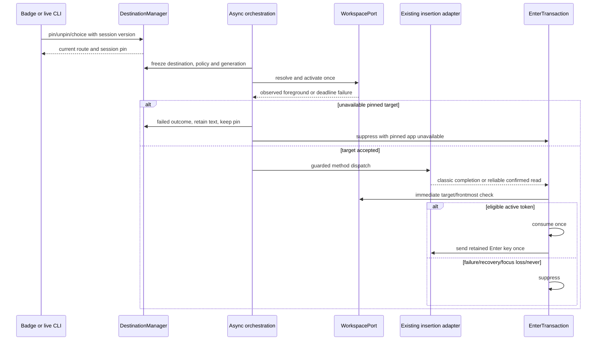
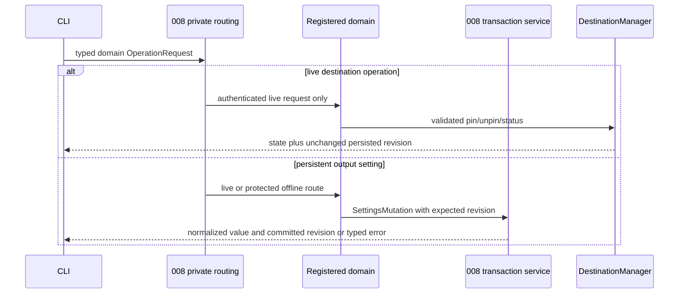
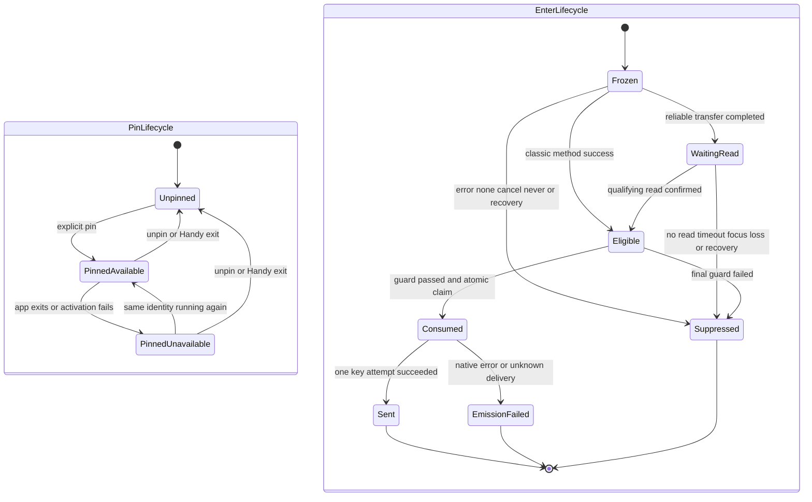
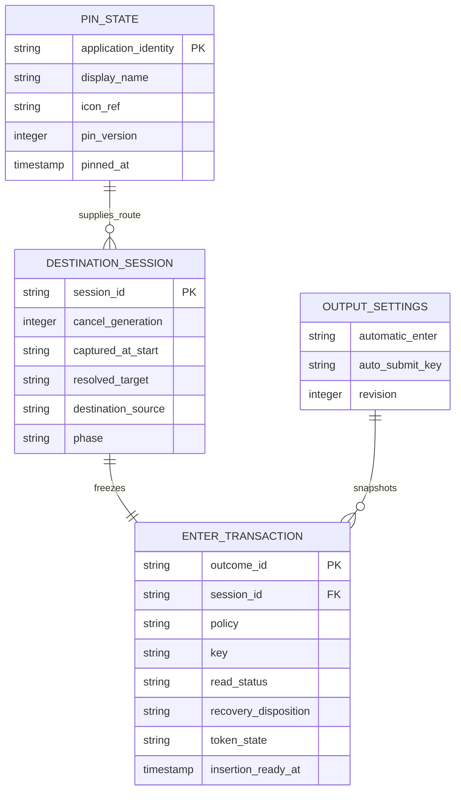

---
penflow_verification_policy:
  livespec:
    generated_docs: required
    homologous_references: required
    native_export: required
    native_geometry: required
    version: 1
---

# Active production plans

## .specs/features/009-pin-mode-and-enter-rule/plan.md (6d343c8828db5cf78f93e0f043f66605a6d25c8727a7edc53f817d102b7adfa2)

---
feature: pin-mode-and-enter-rule
spec_ref: spec.md
title: PIN Mode and Enter Rule Technical Plan
status: Planned
created: 2026-10-12
updated: 2026-10-12
penflow_verification_policy:
  livespec:
    version: 1
    generated_docs: required
    native_geometry: required
    homologous_references: required
    native_export: required
---

# Implementation Plan: PIN Mode and Enter Rule

## Summary

Extend the destination manager with a volatile session pin, migrate auto-submit to one persistent three-value policy, and route every classic/reliable Enter emission through one per-dictation guarded authority.

Inspect [the functional source](spec.md). Scope **L**, despite four FR: native focus/input, asynchronous clipboard receipts, migration and cross-feature state. Deliver after 008, 006 and 007, in the approved order 008 → 001–007 → 009 → 010. This is planning only; no application changes, native tests, mockups or certification are claimed.

Inspect [008's framework plan](../008-settings-cli/plan.md) as technical context. Reuse exactly `SettingDescriptor`, `SettingsMutation`, `SettingsSnapshot`, `Revision`, `PublicSettings`, `OperationRequest`, `SettingsError`, `StoreLocator`, `SettingsRepository`, `LiveSettingsEffects`, `read_snapshot` and `commit_mutation`, and its `settings_service/{descriptor.rs,validation.rs,protocol.rs,errors.rs,store.rs,transaction.rs,live.rs,domains/mod.rs,domains/output.rs}` layout. Keep its persistent revision, stable inter-process lock, private same-user IPC, early `handy settings` branch, domain registration and one renderer. No parallel store writer, transport, revision or CLI executable.

Inspect [006's destination plan](../006-destination-application/plan.md) as technical context. Extend `DestinationManager`, `DestinationSession`, `WorkspacePort`, `InsertionPort`, `InsertionOutcome`, `HistoryPort` and `RecoveryPort`; do not create a second destination manager. Destination selection (006/009), insertion method (existing), clipboard recovery (007) and recovery presentation/classification (010) retain distinct ownership. `insertion_attempted` reports method success, never verified field contents.

## Technical Context

| Aspect | Choice | Reason |
|---|---|---|
| Native / concurrency | Rust 2021, Tauri 2.11.5, existing Tokio | Async activation worker; short thread-bound native operations |
| Frontend | React 18, TypeScript, Zustand, i18next, existing CSS/Tailwind | Native state rendered through existing badge and output settings |
| Serialization / CLI | Existing serde/serde_json and clap; 008 domain trait | Typed policy, domain operations and exact shared envelope |
| Storage | Existing AppSettings JSON for policy/key; RAM for pin and frozen transactions | Pin ends at process exit; no new SQL table |
| Native APIs | 006 macOS/Windows WorkspacePort, existing Enigo/input and paste_tx | No AppleScript or activation workaround; preserve key semantics |
| Tests | Cargo, Bun, Playwright plus real native harness/manual checks | Browser Tauri mocks cannot prove focus, Enter counts or pasteboard reads |
| Infrastructure | Existing local user app only | No cloud, credentials, network API or provisioning |

Inspect [actions/history dispatch](../../../src-tauri/src/actions.rs), [classic paste](../../../src-tauri/src/clipboard.rs), [shared reliable transaction](../../../src-tauri/src/paste_tx/mod.rs), [macOS settle](../../../src-tauri/src/paste_tx/macos.rs), [Windows settle](../../../src-tauri/src/paste_tx/windows.rs), [settings](../../../src-tauri/src/settings.rs), [native overlay](../../../src-tauri/src/overlay.rs) and [current AutoSubmit UI](../../../src/components/settings/AutoSubmit.tsx) before implementation. Currently history depends on `wav_saved`; actions queues paste on `run_on_main_thread`; classic Enter sleeps 50 ms after paste; reliable Enter belongs to platform settle/flush with a 200 ms quiet period. These facts constrain integration; they are not runtime evidence.

## Constitution Check

| Principle | Explicit pass/deviation |
|---|---|
| Preserve native/frontend boundaries | PASS: Rust owns pin, immutable context and key emission; React requests mutations/renders snapshots |
| Stack/managers derived from manifests | PASS: reuse Tauri/Tokio/serde/clap/Enigo and 006 OS ports; no new inference or cloud dependency |
| Availability differs from runtime proof | PASS: resolved versions only; native focus, capture, activation and input gates remain required |
| Changed behavior specified before code | PASS: four FR, six AC and three SC mapped; no semantic spec change during this plan |
| Meaningful tests/current sources | PASS: real destination/Enter logic, injected external ports, actual service/files/processes for integration |
| Naming/tooling | PASS: domain-owned Rust snake_case modules; new TS/Markdown kebab-case; existing files retained; Bun/ESLint/Prettier remain project authority over generic Vitest/Biome/Commander examples |
| Privacy/i18n | PASS: metadata/opaque references only in events; no transcript/window title above debug; labels/reasons through translations |

## Requirement Inventory and Scope

| Requirement | Acceptance / success measure | Steps |
|---|---|---|
| FR-001 | AC-001/002/006; pin lifetime/current override/captured fallback | 1, 2, 3, 6, 7 |
| FR-002 | AC-003; unavailable pin retained, no fallback, text preserved | 1, 2, 5, 7 |
| FR-003 | AC-004/006; three policies, retained keys, SC-002 migration | 3, 4, 6, 7 |
| FR-004 | AC-005; SC-001 zero-or-one matrix, asynchronous guard | 1, 4, 5, 7 |

Entities are session Pin, persisted AutomaticEnter setting and per-dictation destination provenance/EnterTransaction. Interactions are badge/live CLI pin operations, output settings transaction, workspace activation and method completion/read/Enter. No HTTP endpoint; contract tables below are local DTO/CLI design. No OpenAPI file is applicable. A logical ER diagram describes new RAM entities and existing JSON fields, not database migrations.

## Design Reference

| Screen | Component breakdown | Reference/status |
|---|---|---|
| recording-indicator | DestinationBadge pin mark/name; DestinationMenu Pin/Unpin entries above application list | Spec Screens; mockup deferred before spec-ship |
| output-settings | Automatic Enter policy selector; retained independent key selector; unsupported pin hint | Spec Screens; mockup deferred before spec-ship |

## Penflow Contract Inputs

Planned identities are `flow_id: pin-mode-and-enter-rule`, `screen_id: recording-indicator` and `screen_id: output-settings`. The explicit 2026-10-12 user instruction overrides immediate forward-contract/mockup generation: all program flow/screen contracts, semantic/test IDs and Pencil mockups are produced in one pass before spec-ship. Do not mint or regenerate identities during planning.

Inspect [the current semantic tree](../../../penflow/semantic-ui-tree.json) as incomplete context, presently microphone-priority only. The future primary input `penflow/code-ir.json`, expected tree and desktop native geometry are missing. Inspection returned BLOCKED/certified=false, `required_contract_artifacts_missing`. No 009 accepted Penflow history or bound approval is claimed. Do not rewrite the shared root workspace or another feature's source to make this planning gate pass.

The program design owner must later complete cumulative mappings/outcome predicates for these FR/AC, theme and visual states, native geometry, homologous references and native export; produce root ui.pen/semantic/code-ir/expected trees and design registry; run review-snapshot, dispatch the immutable snapshot and all active sources to the independent plan reviewer, retain raw JSON, assemble review-result and record plan-review Done with that bound result. Then require design-profile PASS/certified=true before UI code. Today's semantic review does not substitute for that bound review. Preserve all four procedures as required in metadata; missing inputs are not N/A.

No theme.css/theme.md exists now. Before UI work consume the one-pass theme, install/import it only if its CSS variables are absent, and use its approved tokens/geometry. A 256×50 nonactivating overlay cannot be assumed to fit a menu; Step 1 proves a dedicated nonactivating panel or approved resize without focus theft. Settings keyboard focus is local to the settings window; the badge menu remains pointer-operated per 006, without a global keyboard hook.

## Architecture Decisions

### Pin lifetime, provenance and freeze

Add `PinState {identity, display_name, icon_ref, pinned_at, pin_version}` to DestinationManager RAM. Stable macOS bundle ID and Windows AUMID/canonical executable identity follow 006, excluding Handy. No pin is persisted, exported as a setting, or restored after quit/crash/restart. Status remains pinned even when its app exits. Reopening resolves the same identity using WorkspacePort, not an old PID/display name or an automatic launch; multiple processes follow 006's validated OS activation semantics.

At each actual accepted recording start, obtain and retain `captured_at_start` even when a pin wins selection. Read frontmost before showing Handy surfaces; resolve pin precedence before selecting the captured route. Capture the fallback once, not at unpin time. A queued dictation captures when it really starts. Failed start discards tentative context; if capture cannot be obtained, keep an explicit unavailable fallback, never invent a destination. Audio/AI/processing never recaptures.

Use 006 session_id/version/phase/cancel_generation for every mutation and atomically freeze at Inserting. Pinning while Recording/Processing sets the current route and future pin in one manager transition. Choosing another app is a current-session badge choice only; it keeps PinState and gives source `badge`, so pin_only is false. Unpin before freeze clears PinState and restores captured-at-start source `captured` for the current session, including after a badge override. Preserve 006 return-off behavior for that captured route. Unpin/repin after freeze changes only future sessions; CLI returns the truthful frozen-current/next effect, while the displayed active-session pin mark reflects frozen provenance. Duplicate same-pin/unpin-none are no-ops. Cancellation invalidates callbacks without clearing the session pin.

The badge is visible on supported non-none overlays whenever the current route comes from a pin or a pin exists, even with Return to application off. This implements AC-001 while AC-002 expressly makes PIN activation independent of that setting. Its accessible name for a pinned route is exactly localized `Destination: <name>, pinned`; a temporary other-app route shows that current destination without falsely announcing it is pinned, while the menu still offers Unpin and Pin current destination. With overlay style none, pin operations remain CLI-only; do not create an unsolicited overlay. No pin and return off retains 006 hidden-badge behavior.

### Destination failure and conservation

Freeze a pin route independently of return_enabled; activate its identity even when return is off. Reuse 006's one-shot activation and monotonic ≤1 s deadline, including scheduling/observation; async waits and timers stay off the main thread. Run short native activation/frontmost checks through channels; no worker join, sleep or 1 s loop in run_on_main_thread. Recheck cancellation/target after any configured paste delay and immediately before first method dispatch. None/empty/cancel does not activate or emit input.

Closed/activation-timeout pin is a terminal destination failure with reason `pinned app unavailable`, as AC-003. No current-frontmost fallback, no app launch, no method attempt and no Enter. Keep the pin. Extend 006's typed reason enum and localization/consumer contract; Story 2's illustrative `pinned app closed` is treated as the closed subcase of this AC label, not a second user reason. Retain `InsertionOutcome` status failed and stable outcome_id, history_status and transcript_ref.

Use 006's native retained final-text slot and HistoryPort result; do not rely on a WAV or fabricate a history_entry_id. Test WAV disabled, save failure and saved history reread. Retention is volatile until superseded by a later final outcome, explicit consumer release or process exit; only an actual history save is durable. No new storage guarantee is added. Before 010, 006 displays the reason ≥4 s from visible presentation and retains its existing style-none limitation; when 010 acknowledges presentation its bubble replaces the indicator and inherits ≥4 s. 009 supplies reason/outcome and suppresses Enter; it does not implement the bubble. 007 remains owner of clipboard recovery; 010 Copy uses 007's cancel-open-window-without-restore operation, never an Enter path.

### One setting and idempotent migration

Introduce `AutomaticEnterPolicy {Never, Always, PinOnly}` with serde values `never`, `always`, `pin_only`; retain `AutoSubmitKey` and `auto_submit_key` wire values `enter`, `ctrl_enter`, `cmd_enter`. Persist the new `automatic_enter` policy in existing AppSettings. New installations default Never. On load, if valid new policy is present it wins; otherwise a missing new field maps legacy auto_submit false/missing→Never, true→Always while preserving each key. Invalid present new value is a typed validation/recovery error, never silently enabling Enter. Keep unknown keys/secrets and 008 revision continuity. In-memory reads migrate without writing; startup persists one real migration via commit_mutation and increments once. Repeated migration is a no-op; persistence failure leaves old durable generation.

Remove legacy auto_submit from runtime decisions, editable descriptors, UI, CLI help and command routing in the 009 build. Its raw old key is migration input only, never a second emitter or exposed writable alias. Reject legacy set with validation_failed and guidance to automatic_enter. Existing bool command adapters are retired/translated only during a controlled bindings transition, not retained as a competing setting; tests scan every caller. Keep current key semantics, including platform-dependent Cmd/Super+Enter on Windows/Linux.

Snapshot policy/key with insertion context, so a later UI/CLI setting change cannot turn an outstanding reliable transaction into a different send decision. Reuse 008's fresh typed mutation, descriptor validation, settings-changed revision and latest-response filter. Batch policy+key UI updates are one typed transaction when both change; no two-write inconsistent setting transition.

### Enter authorization and asynchronous receipts

New domain module `src-tauri/src/automatic_enter/` owns pure `evaluate_enter` and per-dictation `EnterTransaction`. Freeze `{session_id, cancel_generation, outcome_id, policy, key, resolved_target, destination_source, method, recovery_disposition}` at insertion entry. resolved_target is the actual selected application identity or None for 006 FrontmostAtEnd/off/unsupported routes; captured-at-start metadata is distinct. Thus AC-005 checks the real insertion destination: no identity comparison to an unused capture in the return-off legacy route. Tests retain both fields and prove this interpretation; no Enter merely because global PinState currently exists.

RecoveryDisposition is an explicit shared `Insert | RecoverInstead | Cancelled` decision from 006/outcome orchestration with optional 010 consumer. Without 010, insertion routes use Insert and failure routes use RecoverInstead. 010 must decide before dispatch and can suppress a pending Enter token before it is consumed; a delayed recovery message never independently creates Enter. Native direct handoff uses transaction state, not an eventual frontend event. Missing/stale required recovery decision blocks authorization.

Eligibility is the conjunction: active generation; method not none; nonempty completed insertion; method success; no recovery-instead; resolved target still frontmost immediately before emission when present; policy Always or PinOnly with frozen source pin. Never is always false. Classic fallback uses the classic method's completion success, not a failed reliable attempt; transferred reliable path additionally requires its qualifying read confirmation. A reliable enqueue Ok is not that confirmation. Acquisition/clipboard setup failure before transfer may use the existing classic fallback; after transfer/no-read/failure never retry or create a second insertion.

One atomic `Pending → Consumed` transition keyed by session/outcome controls every emitter. Classic method completion, macOS receipt/flush/settle and Windows worker/flush all call that authority; remove their direct send_return_key paths. Obtain native input access, evaluate final cancellation/recovery/frontmost under the current token, consume once, then invoke send_return_key once. If focus, input availability or key injection fails, record Suppressed/EmissionFailed and do not retry, even when OS delivery is unknown. Duplicate settle, a new paste flushing the old transaction, stale outcome and callback after quit/cancel cannot generate a second key. Thread-bound main-thread work is short; no lock inversion between paste state, manager, settings lock and Enigo. Copy state out before cross-port calls.

Keep clipboard restoration/quiet-period ownership in paste_tx/007. Separate Enter readiness from 200 ms settle: schedule authorization on the first qualifying confirmed read after completed transfer, without shortening restoration's quiet period. Classic reference time t0 is successful method return (including configured delays); reliable t0 is the first qualifying post-injection read after transfer completes; classic fallback t0 is fallback return. For every eligible dispatched Enter, measure the actual native key attempt within 100 ms of t0, including scheduling/input access and the immediate frontmost check. Never claim this budget for an intentionally suppressed Enter or OS text rendering. Use monotonic Clock and timestamp evidence; no 50 ms main-thread sleep.

The existing read callback proves a post-injection clipboard read, not field contents or necessarily the reader's process identity. Step 1 must test third-party clipboard readers and establish whether the platform receipt plus foreground/transfer context satisfies target-read confirmation. If target-read attribution is not established, that path stays unconfirmed and sends no Enter; a generic observer read must not silently pass AC-005. Record any unsupported receipt attribution as a release blocker for eligible reliable Enter, rather than certify a native guarantee from enqueue/focus alone. A cooperative test field can prove the native scenario but does not prove all applications.

The final focus check cannot atomically bind OS input consumption to a process. Document the residual switch-after-check race; no second activation to force Enter and no retry after uncertainty. External script/direct/clipboard methods retain their existing success contract; they do not verify target text, and partial typing cannot be retracted. Native fixtures compare actual received text/key count separately from method-return evidence.

### CLI domain and local contract

Register `destination` operations through 008's domain trait in `settings_service/domains/destination.rs`; extend its existing output domain, not its IPC or renderer. Live pin mutations are serialized by DestinationManager, use session/pin versions and do not persist or advance settings Revision; response includes the current persisted revision and manager state. Persistent policy/key writes exclusively use commit_mutation, no-op/CAS and existing effects. Generic settings rejects volatile pin fields. An expected persistent revision cannot substitute for a pin-version concurrency token; manager commands serialize actual live state and return that state.

| Command under `handy settings` | Data / effect | Error / exit |
|---|---|---|
| `destination pin <identifier>` | Resolve running non-Handy stable ID; apply pin now before freeze, otherwise next; return pin and current-session effect | absent ID/not running/Handy→not_found/4; no mutation |
| `destination pin current` | Recording/processing: current effective application destination; idle: frontmost non-Handy app; no app→not_found | Typed selection; never arbitrary name/PID or launch |
| `destination unpin` | Clear pin, restore captured current route before freeze; return state; no-op allowed | Live-only; no persistent write |
| `destination status` | pinned identity/name or null, current route/source/phase, support | Live-only even when status would be null |
| `output get [automatic_enter\|auto_submit_key]` | Public descriptor values and persisted revision | Read-only, live or offline; no file creation |
| `output set automatic_enter never\|always\|pin_only` | Shared exact enum validation and commit | Invalid→validation_failed/2 listing values |
| `output set auto_submit_key enter\|ctrl_enter\|cmd_enter` | Existing key validation/semantics and commit | Invalid→validation_failed/2 listing values |

Syntactic/enum validation precedes routing as in 008. For structurally valid destination operations, absent/busy/old/timeout instance returns unavailable/5 first; with a live unsupported platform (including Linux) return validation_failed/2 plus platform reason before workspace lookup, including pin/unpin/status. Supported live lookup failure is not_found/4. Handy never becomes a target. Current while idle in a terminal pins that terminal; document explicitly for script/hotkey users. A running current session with FrontmostAtEnd resolves its current non-Handy foreground at the pin request, with captured fallback unchanged.

Always/Never work on Linux with existing insertion; pin_only remains offered/persistable with an explanatory localized hint that unsupported PIN cannot activate it. Pin UI entries are absent there; no silently rewritten policy. Output setting works offline; all three destination operations are live-only and cannot launch Handy or fall back offline. Shared envelope is exactly `{ok:true,revision:N,data:...}` or `{ok:false,error:{code,message,details:{...}}}` and one newline; diagnostics stderr. Reuse exits 0 success, 1 persistence/internal, 2 usage/validation, 3 revision_conflict, 4 not_found, 5 unavailable; timeout exposes outcome unknown with no blind retry. Reread live status/value before resubmission. No key injection or app activation occurs as a side effect of pin/status itself.

## Gherkin Scenarios and Sequence Diagrams

```gherkin
Feature: Pin selection and asynchronous insertion
  Scenario: Pin and temporary override
    Given ChatGPT is pinned and a dictation captures Safari at start
    When the badge selects Comet for this dictation
    Then the current destination source is badge and the pin stays ChatGPT
    And pin_only sends no Enter for this dictation
  Scenario: Unpin before insertion
    Given a dictation captured Safari and selected pinned ChatGPT
    When unpin is accepted before insertion freezes
    Then the captured Safari route is restored with source captured
    And the next dictation captures its own frontmost application
  Scenario: Pinned application unavailable
    Given ChatGPT is pinned and final text exists without a saved WAV
    When it cannot be activated within 1 second
    Then no method or Enter is dispatched and the pin stays ChatGPT
    And the 006 retained transcript has reason pinned app unavailable
```



```gherkin
Feature: Shared output mutation and live-only pin
  Scenario: Policy update
    Given current revision is 12 and automatic_enter is never
    When output sets automatic_enter to pin_only with expected revision 12
    Then the shared transaction commits revision 13 before confirmation
    And the next insertion snapshots pin_only
  Scenario: Unavailable instance and invalid policy
    Given Handy is not running
    When destination status is requested with JSON
    Then unavailable returns exit 5 and one error envelope
    When output sets automatic_enter to sometimes
    Then validation_failed lists never always pin_only and changes no revision
```



## Gherkin Scenarios and State Diagram

```gherkin
Feature: Pin lifetime and one Enter authority
  Scenario: App restart does not clear pin
    Given the session pin is ChatGPT
    When ChatGPT closes and reopens with a new PID
    Then the pin identity stays and following dictations resolve the running app
    When Handy exits and restarts
    Then no pin is restored
  Scenario: Duplicate asynchronous completions
    Given an eligible reliable transaction has a confirmed read
    When receipt, settle and next-paste flush each notify completion
    Then the transaction emits at most one Enter
  Scenario: No acknowledgement or late recovery
    Given the transfer has no qualifying target read or recovery replaces insertion
    When a settle callback runs
    Then Enter stays suppressed
```



## Data Model

Logical entities only; no new SQL tables or joins, no persisted pin.



## Implementation Plan

### Step 1 — Prove native surface, capture and receipt feasibility

**Prerequisite:** Independent semantic plan review complete+ready; implement progression and deferred program design gates resolved before UI production.
**Required inputs:** Existing overlay/workspace/paste_tx, 006/008 delivered interfaces, native test field and safe private fixtures.
**Action:** Extend planned `src-tauri/tests/destination_platform.rs` with pin capture/unpin/no-focus cases; new `src-tauri/tests/enter_platform.rs` and `scripts/pin-enter-native-proof.ts` spike real receipt attribution, key timing and focus switches. Reuse 006 nonactivating menu surface; no production pin wiring yet. Prove capture fallback while pinned, return-off badge, pointer menu and keyboard settings separately. Measure UI heartbeat during ≤1 s activation and pending reads, real key counts and foreground traces on macOS early, Windows before platform delivery.
**FR covered:** FR-001.1: Capture and surface feasibility, FR-002.1: Activation failure feasibility, FR-004.1: Receipt and Enter feasibility
**Execution evidence:** Binary/OS/app hashes, focus/heartbeat/receipt/key timestamps, native observer attribution notes and geometry export after the later design pass.
**Success criteria:** No menu focus theft or activation wait freeze; fallback captured once; eligible Enter ≤100 ms; reader evidence discriminates target confirmation from third-party reads, or explicit unsupported-path blocker.
**Failure handling:** Native feasibility or attribution failure blocks affected release path; do not infer success from browser callbacks or a post-injection observer read.

### Step 2 — Extend destination manager with session pin

**Prerequisite:** Step 1 viable capture/surface mechanics; 006 DestinationManager delivered.
**Required inputs:** session phases/versions, WorkspacePort identities, capture fallback and outcome/recovery contracts.
**Action:** New `src-tauri/src/destination/pin.rs`; modify `destination/{mod.rs,session.rs,workspace.rs,outcome.rs}`, `actions.rs` and `transcription_coordinator.rs` to add PinState, frozen source pin, saved captured_at_start, atomic current/future transitions and typed pinned-unavailable reason. Reuse native adapters; register no second manager. Inline unit tests and new `src-tauri/tests/pin_destination.rs` test real manager through fake workspace/clock/output ports.
**FR covered:** FR-001.2: Volatile pin and frozen provenance, FR-002.2: Retained unavailable pin
**Execution evidence:** Transition matrix including before/at/after freeze, queued actual starts, cancellation, restart identity, no pin serialization.
**Success criteria:** Pin wins despite return off; override affects current only; unpin restores capture with source captured; unavailable never falls back or clears pin; restart Handy resets it.
**Failure handling:** Lost fallback, stale mutation or wrong application dispatch is P0; block downstream wiring until repaired.

### Step 3 — Migrate settings and register CLI domains

**Prerequisite:** 008 delivered service/domain framework and Step 2 typed manager commands.
**Required inputs:** Raw legacy/new settings, descriptors/validators, private live routing and output renderer.
**Action:** Modify `settings.rs`, `settings_service/{descriptor.rs,validation.rs,live.rs,domains/mod.rs,domains/output.rs}`; new `settings_service/domains/destination.rs`. Add AutomaticEnterPolicy and migration, live-only pin domain, output policy/key get/set, volatile projection and no-op/CAS rules. Modify `commands/destination.rs`, `shortcut/mod.rs`, `commands/mod.rs`, `lib.rs` for one shared command adapter and retire bool setters; regenerate bindings.ts through supported specta export only during implementation. New `src-tauri/tests/{pin_enter_cli.rs,automatic_enter_migration.rs}` use real production service and isolated stores/process channels. Update application README during implementation for commands and current-terminal/unknown-outcome caveat.
**FR covered:** FR-001.3: Live pin domain and UI parity, FR-003.1: Policy migration and descriptors
**Execution evidence:** Each legacy bool × key migration, new/old precedence, no-op/read hashes, failure/CAS/concurrency transcripts, JSON/exit fixtures and binding caller inventory.
**Success criteria:** One canonical setting/emitter source; unknown fields preserved; reads do not write; pin never increments persistent revision; absent instance/unsupported/lookup precedence exact.
**Failure handling:** Independent writer, bool writable shadow, false success or secret/text stdout blocks CLI/UI exposure; persistence/timeout outcome stays truthful with no blind retry.

### Step 4 — Centralize pure Enter policy and token

**Prerequisite:** Stable frozen destination/outcome and new policy types; all old emitter call sites inventoried.
**Required inputs:** Exact AC-005 conjunction, monotonic Clock, native KeyEmitter, workspace/recovery/cancel ports.
**Action:** New `src-tauri/src/automatic_enter/{mod.rs,policy.rs,transaction.rs}` implement evaluate_enter, immutable context, one atomic claim and timestamps; expose crate-local API in lib.rs. Inline table/property-style exhaustive tests cover all option × source × outcome branches, false predicates individually and combined, all keys and duplicate concurrent callbacks. New `src-tauri/tests/enter_gate.rs` tests real state with output spies only, not a mock gate.
**FR covered:** FR-003.2: Retained policy and key semantics, FR-004.2: Guarded zero-or-one authority
**Execution evidence:** Independent expected decision matrix, claim-race barriers, ready-at/send-at timestamps and failure reason assertions.
**Success criteria:** Exactly expected 0/1 for 100% of enumerated matrix (SC-001); stale/cancel/recovery/no-read/none/focus/never prevent key; source badge/captured never qualifies pin_only.
**Failure handling:** Any extra/missing eligible key or mutable global pin/settings dependency is P0; repair before platform emitters migrate.

### Step 5 — Integrate classic and reliable paths and conservation

**Prerequisite:** Steps 2–4 PASS; native spike validates allowed receipt/dispatch paths.
**Required inputs:** Existing clipboard/input and platform paste_tx, 006 outcome producer, 007 restore ownership, optional 010 recovery decision.
**Action:** Modify `clipboard.rs`, `paste_tx/{mod.rs,macos.rs,windows.rs}`, `actions.rs` and `destination/outcome.rs` to pass frozen EnterTransaction, replace every direct auto-submit call, emit readiness at method return/qualified receipt and keep restore quiet-period independent. Preserve classic pre-transfer fallback and configured method semantics. Use 006 async worker/brief main-thread calls, not a 1 s wait or 50 ms sleep in main callback. Preserve outcome/transcript when WAV/save fails; handoff reason to 006/010 without clipboard policy changes. New `src-tauri/tests/enter_insertion.rs` exercises real adapter completion/flush/cancel/restore ordering.
**FR covered:** FR-002.3: Failure conservation and no fallback, FR-004.3: Single classic reliable emitter
**Execution evidence:** Remaining-emitter scan, actual path tests on both OSes, fallback/no-read/third-party-read/partial-failure matrix, saved-history reread and RAM lifetime evidence.
**Success criteria:** No competing key path; never Enter before method/read success; eligible key within 100 ms of defined t0; restoration stays 007-owned; generation/recovery guards hold at final dispatch.
**Failure handling:** Unknown key delivery consumes token without retry; missing target read/focus evidence suppresses key and blocks corresponding release proof; partial text is reported truthfully.

### Step 6 — Deliver badge and one accessible settings control

**Prerequisite:** Program one-pass Penflow/code-ir/theme, bound review and design-profile certificate; native nonactivating surface spike PASS; backend commands stable.
**Required inputs:** Planned flow/screen IDs, cumulative approved semantic/test IDs, generated bindings and revisioned snapshots.
**Action:** Modify 006 `src/overlay/{destination-badge.tsx,destination-menu.tsx,destination-state.ts}`, existing RecordingOverlay.tsx/CSS and overlay.rs for pin mark/entries/return-off visibility; new `src/components/settings/automatic-enter.tsx` replaces AutoSubmit.tsx at every import. Modify settingsStore.ts/useSettings.ts and en/fr translations, reconcile locales through existing translation checks. Add policy and key controls with existing Dropdown/SettingContainer, Tab order, visible focus and announcements. New `src/overlay/pin-state.test.ts`, `src/components/settings/automatic-enter-state.test.ts` and `tests/pin-enter-ui.spec.ts` follow actual tests directory. Narrow Tauri capability only if reused surface/command needs it.
**FR covered:** FR-001.4: Badge pin entries and accessible name, FR-003.3: One policy and retained key UI
**Execution evidence:** Current approved IDs/IR + UI snapshots, keyboard/a11y assertions, stale-event/version tests and real native focus timeline.
**Success criteria:** Pin/Unpin above list; no duplicate legacy control; exact pinned accessible name; selection saved/announced, selectors focus in reading order; none/unsupported behavior exact.
**Failure handling:** Missing design proof blocks UI code; focus theft/hidden active pin/duplicate control or inaccurate pinned route label blocks release.

### Step 7 — Prove acceptance and neighboring regressions

**Prerequisite:** Steps 1–6 PASS; actual release binaries and platform operators available.
**Required inputs:** Independent AC/FR/SC inventory, safe test phrases, private settings, native transcript/key observer.
**Action:** Run resolved commands and native harness below; capture ChatGPT five consecutive dictations from three other apps (SC-003), Comet/Notes quit/reopen, none/off/unsupported, all keys/options/methods, multiple windows/Spaces, temp override/unpin timing and CLI parity. Test 010 recovery instead and stale delivery through injected RecoveryPort before 010 ships; rerun actual 010 bubble/Copy integration after delivery. Keep 007 restore policy untouched. Attach actual assertion matrix/timing/focus/history evidence to spec-test; no program code/commit from this plan.
**FR covered:** FR-001.5: Pin route native acceptance, FR-002.4: Unavailable preservation acceptance, FR-003.4: Migration UI CLI acceptance, FR-004.4: Native matrix and timing proof
**Execution evidence:** Build hash, commands/exits/raw test reports, per-app text and native Enter counts, every timing sample, screenshots/export and AC/SC matrix.
**Success criteria:** Every AC/SC has sufficient zero-failure evidence; every eligible key meets ≤100 ms; five dictations reach pinned ChatGPT; no unexplained platform gaps or false history/read certification.
**Failure handling:** Preserve missing OS/native/010 integration as explicit blocker; no tool version, browser mock or method-return assertion substitutes for native behavior.

## Resolved Test Commands

Availability checked 2026-10-12 only; no application tests/builds run by this planning command. No surfaces.yaml exists; Playwright testDir is `tests`, Rust integration target directory is `src-tauri/tests`. Proposed targets/harness below do not exist yet.

| Action | Command | Tool / availability |
|---|---|---|
| Rust units | `cargo test --manifest-path src-tauri/Cargo.toml --lib automatic_enter`; `cargo test --manifest-path src-tauri/Cargo.toml --lib destination` | Cargo/rustc 1.94.0 available; tests planned |
| Pin and gate integration | `cargo test --manifest-path src-tauri/Cargo.toml --test pin_destination --test enter_gate --test enter_insertion` | Cargo available; targets planned/native build unverified |
| Migration and CLI | `cargo test --manifest-path src-tauri/Cargo.toml --test automatic_enter_migration --test pin_enter_cli` | Same real 008 service/IPC; planned |
| Native adapters | `cargo test --manifest-path src-tauri/Cargo.toml --test destination_platform --test enter_platform` | Planned; execute on macOS and Windows |
| Full Rust | `cargo test --manifest-path src-tauri/Cargo.toml` | Resolved, not executed |
| Frontend state | `bun test src/overlay/pin-state.test.ts src/components/settings/automatic-enter-state.test.ts`; `bun run test:keyboard` | Bun 1.3.9 available; state tests planned, keyboard script existing |
| Browser/UI/visual | `bun run test:playwright -- tests/pin-enter-ui.spec.ts` | Local playwright binary absent; TOOL NEEDED `bun install`, then `bunx playwright install chromium`; no visual baseline yet |
| Native proof/manual | `bun scripts/pin-enter-native-proof.ts --binary <absolute-release-binary> --platform <macos\|windows> --out <proof-directory>` | Bun available; proposed harness, manual observations required |
| Type/build | `bunx --no-install tsc --noEmit`; `bun run build`; `cargo check --manifest-path src-tauri/Cargo.toml` | Local tsc absent; install pinned ~5.6.3 deps; native SDK/model prerequisites remain unverified |
| Lint | `bun run lint`; `cargo clippy --manifest-path src-tauri/Cargo.toml --all-targets -- -D warnings` | Local eslint absent; clippy 0.1.94 available |
| Format | `bun run format:check`; `cargo fmt --manifest-path src-tauri/Cargo.toml -- --check` | Frontend deps absent; rustfmt 1.8.0 available |
| Translations | `bun run check:translations` | Existing script; run after locale changes |
| Full acceptance | Rust + state/keyboard + UI + type/lint/format/translations + macOS/Windows native evidence + Linux non-PIN regression | Future composite gate; no runtime PASS claimed |

## Testing Strategy

| Priority/level | Concrete planned file and assertions | FR/AC/SC |
|---|---|---|
| P0 unit/integration | pin.rs / pin_destination.rs: capture even pinned, current/future pin, temp override, unpin before/freeze/after, quit/reopen/Handy exclusion, return off/none/queued start | FR-001/002; AC-001/002/003 |
| P0 pure gate/race | policy.rs / transaction.rs / enter_gate.rs: full option × frozen source × outcome × key matrix; falsify each predicate, duplicate concurrent receipt/settle/flush, stale token, input failure | FR-004; AC-005; SC-001 |
| P0 real method boundary | enter_insertion.rs: classic/direct/script success/failure/partial, none, reliable transfer/read/no-read/fallback/error/cancel, observer read, recovery instead, focus switch before Enter, no duplicate classic + settle | FR-004; AC-005; SC-001 |
| P0 migration/file | automatic_enter_migration.rs: 2 bool × 3 key combos, missing/new fields, new precedence/invalid, unknown fields/secrets, repeated migration/no-op, startup failure/CAS/races against genuine 008 service | FR-003; AC-004; SC-002 |
| P0 real CLI | pin_enter_cli.rs: live/current/identifier/status/null/unpin, no instance, unsupported precedence, invalid enums, not_found/Handy, one JSON envelope, codes/revisions/no persisted pin, UI parity | FR-001/003; AC-006 |
| P0 conservation | pin_destination.rs + enter_insertion.rs: closed/timeout and WAV off/save error/saved; actual history reread, retained native ref, no fallback, pin stays, 006 reason ≥4 s and later 010 ack | FR-002/004; AC-003/005 |
| P1 frontend/visual | pin-state.test.ts / automatic-enter-state.test.ts / pin-enter-ui.spec.ts: every menu entry/current mark/name/pin label, return-off/none/unsupported, keyboard/Tab/announcement, selector values, duplicate control absence | FR-001/003; AC-001/004; Behavioral AC |
| P1 native acceptance | destination_platform.rs / enter_platform.rs / pin-enter-native-proof.ts: real focus/read/key count, five ChatGPT dictations from three other apps, Comet/Notes restart, Windows restrict activation, menu no activation, heartbeat | FR-001–004; AC-001–006; SC-003 |
| P1 latency/regression/privacy | same native harness: each t0→key ≤100 ms, activation ≤1 s, old methods/keys/delays/clipboard policy, no text/title non-debug logs, Linux Always/Never/pin_only, 010 Copy restores no clipboard and creates no key | FR-002–004; AC-004/005/006; QE expectations |

Inject WorkspacePort (frontmost/enumeration/activation/identity), Clock (deadlines/ready/send), KeyEmitter, InsertionPort/ClipboardPort (method/read/restore effects), HistoryPort and RecoveryPort; real manager/policy/migration/service logic is never mocked. Audio enumeration uses its owning AudioDeviceCatalog seam; AX classification belongs to 010's classifier seam and LLM completions to the existing post-process client seam. 009 does not add calls to these three owners; pipeline tests inject completions/failures to prove pin remains stable through audio/AX/recovery/LLM delay. Use barriers/callbacks/deadlines, not arbitrary sleeps. Real file/channel/process integration uses private stores and native fixtures, never the production user store.

Native proof records binary SHA/OS/app versions, method/policy/key and return/overlay style, frozen source and target/capture, actual activation/frontmost timeline, transfer/read provenance, t0 and key-attempt timestamp/result/count, event-loop heartbeat, actual received text (safe fixtures), history_status/ref lifetime and reason visible start/end. Manually observe app switching, multiple windows/Spaces, menu focus and settings screen-reader behavior on macOS and Windows separately. Clipboard/read receipts, method completion and actual field contents are three distinct evidence levels. Windows proof cannot be inferred from macOS, and Linux has no PIN support claim.

## QE Analysis

Criticality **High**; blast radius **Cross-system** (automatic sending to native apps); primary risk **Functional/Security**; confidence **Medium in planned logic, low in native receipt/focus proof**. Consider functional correctness, regression, contract compatibility, data/migration/conservation, privacy/security, performance, accessibility/UX and observability.

| Gate | Owner/evidence | Gap and blocking rule |
|---|---|---|
| Plan quality | Planner/independent reviewer: current raw semantic receipt + structural/Analyze/progression | Documentation only; bound Penflow review remains later program gate |
| Native feasibility P0 | Native implementer: Step 1 receipt/foreground/menu/heartbeat traces | Missing reader attribution or UI freeze blocks affected path |
| Enter safety P0 | Implementer then spec-test: matrix, token race, final guard, every emitter inventory | Any duplicate/unauthorized key blocks release; method success is not text verification |
| Migration/contract P0 | Real 008 service/process tests, raw generations, UI parity and CLI exits | Shadow bool/store writer/CAS loss/false revision blocks delivery |
| Conservation P0 | History matrix + volatile retention and 006/010 handoff proof | WAV/save absence never called durable saved history |
| UI/visual P1 | Program design owner: cumulative planned IDs, code-ir, bound snapshot/result, design certification; spec-test runtime | Current Penflow incomplete; no UI code before program design gate |
| Native timing/a11y P1 | Platform operator: all t0 samples ≤100 ms, activation ≤1 s, native focus/key/screenshots and keyboard announcement | Missed budget/focus theft/unsupported OS proof blocks claimed support |
| Evidence integrity | Verifier: actual build-bound acceptance matrix/transcripts | Planned commands/tool versions/fixture receipts do not certify runtime |

Expected later artifacts under `proofs/009-pin-mode-and-enter-rule/<os>/`: acceptance-matrix.json, enter-matrix.json, focus-timeline.json, read-attribution.json, timing.json, migration-generations.json, history-matrix.json, native-observations.md and raw commands/screenshots/native export. These are proposed outputs, not existing proof. QE chooses sufficiency; independent review judges design, native security review inspects FFI/input/privacy boundaries, Penflow owns visual authority and spec-test executes runtime proof. This plan is not a security audit or a certification of focus/read/input behavior.

## Risks & Considerations

Disposition covers every original spec-review warning/info and the refreshed review:

| Finding / risk | Decision, test or documented boundary |
|---|---|
| 006/008/010 dependency | Implement after 006/008/007; typed optional RecoveryDisposition input and injected 010 suppression tests; actual 010 integration rerun after its later delivery |
| Mockups/undefined visual trait states | Stable planned flow/screen IDs; one-pass cumulative contracts/states/IDs/Pencil + bound review/design gate before UI code; no design produced now |
| Pin hidden when return off | Show badge for active pin/current pinned route on supported visible overlay; style none stays CLI-only; native/UI tests |
| Closed versus unavailable reason label | Canonical AC-003 `pinned app unavailable`; closed/timeout retain diagnostic subtype, one translated user reason |
| AC-005 captured app with return off | Distinguish unused capture from effective insertion target; FrontmostAtEnd target None preserves today's route; explicit pin always has target; test source/target pair |
| 100 ms undefined asynchronous anchor | Classic success return; reliable confirmed read after transfer; fallback success return; independent Enter scheduler, restore quiet-period retained; every eligible timestamp tested |
| Missing Rust/native runner strategy | Commands, planned targets/harness and real manual protocol explicit here; shared strategy intentionally untouched during concurrent plans |
| Async global pin/settings races | Freeze provenance/policy/key per transaction; current changes affect future after insertion freeze; atomic token + cancel/recovery/focus final guard |
| pin current in terminal | CLI help explicitly says idle current is the frontmost terminal if typed there; script/hotkey invocation or stable identifier needed for another app |
| Linux pin_only/error precedence | Keep value with explanatory hint and zero eligible PIN routes; no instance unavailable first, live unsupported validation_failed; Never/Always unchanged |
| Refreshed fallback capture/unpin race | Capture once at actual start even pinned; serialized manager version and Inserting freeze; never recapture at unpin |
| Refreshed native focus race | One authority, immediate foreground check, no forced second activation; unavoidable post-check input race recorded as residual risk, no field verification claim |
| Refreshed WAV-gated conservation | 006 volatile retained text independent of WAV; actual history save only; release/supersession/exit lifetime explicit |
| Refreshed migration all emitters | Remove classic + macOS settle/flush + Windows worker/flush bool paths/setters/UI/CLI descriptor; matrix/scan proves no second authority |
| Third-party reliable receipt reader | Current callback is not guaranteed target identity; Step 1 native attribution gate; unconfirmed path sends no key and cannot claim eligible reliable Enter support |
| Direct/script partial failure | Existing method contracts retained, cannot retract delivered characters; no retry/fallback to wrong app, recovery and emission uncertainty truthful |

## Next Action

After current complete+ready semantic review and READY implement progression, the implementation entry is `$spec-implement 009-pin-mode-and-enter-rule --model=gpt-6.1-sol`, respecting prior delivery and the program's deferred UI contract/design gate. This command is a plan only; it does not run implementation, modify other features, commit or push. Global registry/changelogs are finalized only by LiveSpec with lock retry.

